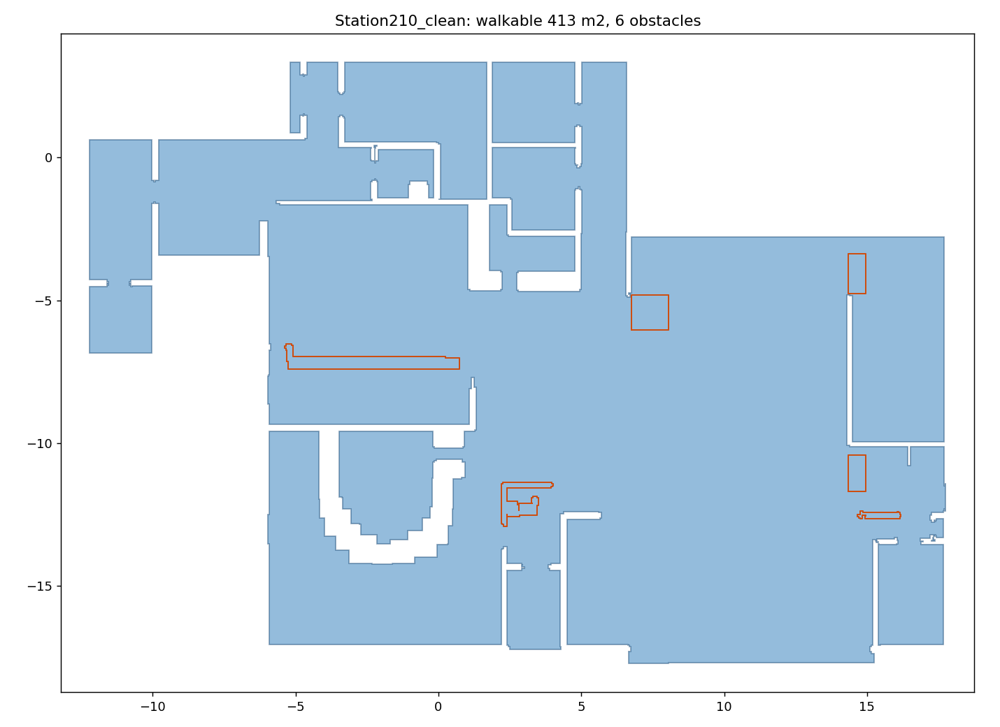

# The Station nightclub — walkable area

**NCSTAR 2 App. L.2.2 deck (FDS 4.0), transcribed; transcriber undocumented.** See [Provenance](#provenance) (#377).

`geometry.wkt` is **derived from `Station210_clean.fds`**, the NIST model, not
reconstructed by hand:

```bash
.venv/bin/python assets/station/extract_walkable.py \
    assets/station/Station210_clean.fds \
    -o assets/station/geometry.wkt --plot assets/station/walkable.png --report
```



| | |
|---|---|
| walkable | **412.8 m²**, 6 obstacles |
| extent | 30.0 m (x) × 21.1 m (y), L-shaped |
| vertices | 705 on the exterior ring and 130 on the 6 holes, in deck coordinates (not on a 0.1 m grid) |
| `jps.RoutingEngine` | accepts it |

## Checked against the dimensioned plan

| NCSTAR plan | extracted | |
|---|---|---|
| front elevation 24.2 m | 23.7 m | inside face of the walls, so ~0.5 m narrower — as expected |
| depth 20.9 m | 21.1 m | |

The 24.2 m dimension spans the **front elevation only**; the west wing extends
further left, which is why the overall extent is 30 m.

Every named space routes to the front door — the check that matters for an
evacuation geometry, and a stronger one than polygon validity:

```
west wing (dart room)   13 waypoints      dance floor    7 waypoints
raised platform         15                sunroom       10
rear corridor           10                main bar       6
```

## The four exits are named in the deck

Useful when placing exit stages by hand — this is transcription, not guesswork:

| deck name | position | plan label |
|---|---|---|
| `FRONT DOOR` | x 2.44–4.34, y ≈ −17.3 | Front Entrance Doors |
| `SIDE DOOR` | x ≈ −6.0, y −8.6…−7.6 | Kitchen Exit Door |
| `SIDE DOOR` | x ≈ −6.0, y −13.5…−12.5 | Main Bar Side Exit Door |
| `BACK` | x ≈ 17.7, y −12.38…−11.39 (`T_REMOVE=29`, `SURF_ID='FOAM'`) | Platform Exit Door |

`back door qqq` and `back door www` are the 0.1 m jambs either side of `BACK`
(y −11.39…−11.29 and −12.48…−12.38), not the door.

Windows are **not** exits here, though 27.9 % of survivors left by one. That
limitation is discussed in the validation spec, not worked around.

## Ignoring baseboards and toe kicks

`--ignore-layer PREFIX` (repeatable) leaves out the obstructions of a layer. The
default ignores nothing, so `geometry.wkt` is what the command above writes. The
deck draws baseboards (`A-WDWK-BAY`, z 0-0.111 m, some at z 0.15-0.26 m) and toe
kicks (`A-CASE-TOEA`, z 0-0.10 m) as obstructions; they are 0.1 m proud of a
wall or counter and narrow a doorway or a casework gap that a person walks
through. A z-band floor cannot drop them, because the baseboard under the speaker
at (14.38, -3.07) sits at z 0.15-0.26 m. `assets/station_nist` extracts with both
layers ignored.

## Extraction narrows doorways

Thin (zero-thickness) obstructions are widened by `--half-cell` (0.05 m) on
each side so they have substance, so an opening framed by two of them loses
0.10 m. Measured on `geometry.wkt`:

| opening | deck | `geometry.wkt` |
|---|---|---|
| front interior door, y -14.36 (leaves at x 2.97 / 3.88; NCSTAR 914 mm) | 0.91 m | 0.81 m (x 3.02-3.83) |
| main-bar / front-of-house opening, x 2.3, y -13.67...-12.86 | 0.81 m | 0.71 m |

The 0.81 m front gap is therefore an artefact of this widening, not a measured
door width. Any use of the polygon that depends on doorway widths has to
classify the narrow gaps against the deck first.

## Three decisions the extraction rests on

**Interior doors open, exterior doors stay shut.** Both had to be told apart and
neither name nor CAD layer does it: the deck carries `A-DOOR-STND-1` beside
free-text `door 5i`, `FRONT DOOR`, `back door qqq`. The rule is positional —
seal every door, find the outdoors as the region touching the mesh edge, and a
door fronting onto it is exterior. Of 74 door obstructions in the height band,
**8 stay shut and 66 open**.

Getting this wrong is not subtle. A prefix-only rule left `door 5i` sealing the
entire west wing (374.7 → 311.4 m²); opening *every* door instead let the
walkable area leak out of the building and collapse to 20.3 m².

**The platform handrail is treated as passable.** This is a modelling decision,
not an observation. `A-HRAL-RAIL`/`NWEL` at 0.15–1.06 m is a real barrier, and
leaving it solid cuts the raised platform off entirely — 37 m² that nobody can
enter or leave. But a 2-D walkable area cannot represent the stair opening in a
railing, nor the level change the railing guards. Occupants demonstrably stood
on the back wall platform and got off it, so an unreachable platform is the
worse error.

*Consequence, stated so it is not discovered later:* agents may cross the
platform edge anywhere, not only at the stairs (x 16.45–17.77, y −11.13…−10.11).

**Everything not horizontal blocks.** Walls, bars, counters, fixtures and
woodwork are obstacles; floors, ceilings, carpet, stair treads and risers are
not. `--report` prints the per-layer footprint and verdict so the classification
can be audited rather than trusted.

## The 412 m² figure

The area is **412.8 m²**. The "412 m²" quoted in the validation spec is the
gross footprint of NCSTAR 2 Vol. I §1.2 (p. 1-1), "about 412 m² (4484 ft²)",
whose own conversion is inconsistent (4484 ft² is 416.6 m²); Vol. I Table 7-4
(p. 7-16) totals 406 m² of use areas. Neither is a walkable area, so the match
with 412.8 m² confirms nothing.

## Provenance

What is established, from published sources:

- `Station210_clean.fds` is the listing in NIST NCSTAR 2 Vol. II, Appendix L.2.2,
  "Full Nightclub, Un-sprinklered" (pp. L-17 to L-59, `CHID='Station210'`,
  FDS 4.0; [doi:10.6028/NIST.NCSTAR.2v2](https://doi.org/10.6028/NIST.NCSTAR.2v2)).
  Header, the 8 meshes, `REAC`, the 6 `SURF`, 15 `RAMP`, 10 `VENT`, 48 `SLCF`
  and every `T_REMOVE` match the print in order. Only `CHID` was renamed.
  `T_REMOVE` matches Vol. I Table 5-6.
- It is still FDS 4 syntax (`&GRID`/`&PDIM`, `TWFIN`) and does not run in FDS 6.
- The print repeats many `OBST` lines verbatim, up to 17 times. The appendix has
  about 3,030 `OBST` lines and the deck 2,239: the exact repeats (about 740) were
  removed and nothing else was found missing. Coincident objects with a different
  layer or `SURF_ID` are kept. A repeat fills the same cells, so neither the
  evacuation geometry nor the fire changed. This was checked by matching against
  the OCR text of the PDF, not line by line.
- The deck reproduces a line wrap of the printed page (a lone `DOOR` line after
  `BACK`) and stray `1` lines where the OCR layer loses digits. So it was most
  likely transcribed from the PDF, not from an electronic NIST file.

What it is not:

- It is not the geometry FDS 4 computed: FDS snaps obstructions to the 0.1 m grid
  (Vol. I §5.1.1, p. 5-3).
- Exterior door widths are fire openings: front 1.90 m, side doors 1.00 m,
  platform door (`BACK`) 0.99 m. Vol. I Table 7-6 gives 1829 mm (1727 mm clear)
  and 914 mm. The interior front door (0.914 m) matches Table 7-6, but both come
  from photographs and CAD at nominal 36 in, so they are not independent
  ([doi:10.6028/NIST.NCSTAR.2v1](https://doi.org/10.6028/NIST.NCSTAR.2v1)).
- It writes no soot, visibility or CO output (its slices are temperature, oxygen
  and gauge heat flux), so extinction-based coupling needs a ported deck and a
  new run.

Not known: who transcribed and corrected the listing, and whether the printed
deck is the one NIST ran. Vol. I §5.3.2 gives a 35 s burner and §5.3.1 gives mesh
lengths up to 21.6 m; the listing has no burner cut-off and meshes of 22.6 m.
NIST's electronic FDS 4 input would settle both. This study uses published
sources only and has not requested it.

## Related

- `extract_walkable.py` in this directory — the extractor, and the two FDS
  format traps it documents (`XB` is `x0,x1,y0,y1,z0,z1`; zero-thickness
  obstructions need their degenerate axis widened).
- `build_geometry.py` in this directory is an earlier **hand reconstruction**
  from the dimensioned plan, superseded by the extraction and kept only for
  reference.
