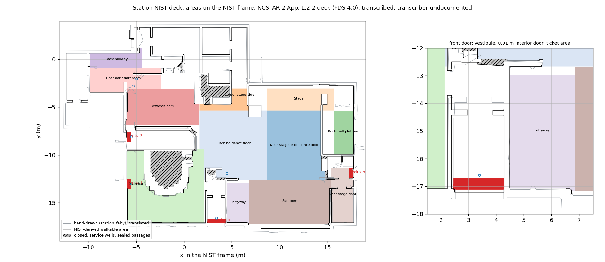

# Station, Fahy Table 2 on the NIST-derived geometry

**NCSTAR 2 App. L.2.2 deck (FDS 4.0), transcribed; transcriber undocumented.** The walkable area comes from
`assets/station/Station210_clean.fds`; its provenance is in
[`assets/station/README.md`](../station/README.md#provenance) (#377).

The same 333 survivors, familiarity classes and agent parameters as
[`station_fahy`](../station_fahy/), on the NIST geometry instead of the
hand-drawn one. Nothing is copied: `build_scenario.py` imports the areas
(`areas.RECTS`, `PRIORITY`), the Fahy table and the classes from `station_fahy`.
`station_fahy` carries the same V0 settings; its front exit moved to the
doorway line (CHANGELOG, [Unreleased]).

```bash
.venv/bin/python assets/station_nist/build_scenario.py            # config.json, geometry.wkt
.venv/bin/python assets/station_nist/build_scenario.py --tables   # the tables below
.venv/bin/python assets/station_nist/build_scenario.py --full     # + config_full.json
.venv/bin/python assets/station_nist/build_scenario.py --t-jam 71 --out DIR  # sensitivity, see Routing
.venv/bin/python assets/station_nist/plot_overlay.py              # overlay.png
.venv/bin/python run.py --scenario assets/station_nist --seed 4
```



## Status

The committed configs carry the Station V0 settings (time zero is first flame):
the front exit closes at 86 s, pre-movement is uniform per Galea et al. 2008
(main hall 25-30 s, front of house 30-35 s, back hallway 35-41 s), the horizon
is 250 s and `w_queue = 0`. Clear-air runs on seeds 4-23 of `config_full.json`
(WarpDriver, 455 agents, radius unchanged) place every agent and **all 20 end
by evacuation** (134.1-179.6 s, median 150.0 s); none deadlocks and none
reaches the 250 s horizon. At 86 s, 4-8 agents (median 6) stand in the
vestibule; they are re-routed, not trapped. Before the V0 settings, runs
without pre-movement or the jam, under a 600 s cap, ended at 96.6-126.0 s
(median 107.1 s). No Fahy outcome was used to choose any of this (no T1, T2
or W).

Before the dart room took the hand deck's east edge (-6.0), seed 14 stopped
with JuPedSim's "Point (16.955, -13.426) is outside of accessible area" at a
notch of the platform-door recess: the upstream defect jupedsim#1720. The
notch is unchanged, so the defect can still end a run.

## Clearance floor and disclosure

Every opening agents use is at least **0.90 m**, and the front interior door is
0.91 m. The NCSTAR door widths are 0.81-0.91 m. WarpDriver (JuPedSim 1.4.2) does
not pass agents of radius up to 0.23 m through narrower openings
(jupedsim#1719), so a narrower real door cannot be modelled as it is. `station_fahy`
has the same 0.9 m floor (`simplify_doors.py`).

> Openings narrower than 0.9 m in the NIST-derived deck are widened to 0.9 m
> (NCSTAR door widths are 0.81-0.91 m) because WarpDriver (JuPedSim 1.4.2) does
> not pass agents with radius up to 0.23 m through narrower openings
> (jupedsim#1719); bar service wells hold no agents. Egress times through these
> openings are therefore not limited by their real width.

Fixture passages under 0.9 m that are not the only access are sealed; bar
service wells (the main-bar well behind the horseshoe counter and the rear-bar
well behind the L-shaped counter, x 1.75-4.85, y -4.0...-1.5) hold no agents.

## Frame

Translation only, hand frame to NIST frame: **(+3.635, -8.366) m**. A chamfer
fit of the hand building interior to the NIST walkable boundary gives a median
residual of 0.07 m and a 90th percentile of 0.40 m. A similarity fit (rotation
-0.21 deg, scale 0.992) is a reported sensitivity and is not used.

### Landmark residuals

Hand-drawn landmark translated into the NIST frame, against the NIST deck.
Gate: each at most 0.5 m or listed with a reason.

| landmark | hand + T | NIST | residual | |
|---|---|---|---|---|
| building x min | -12.36 | -12.21 | 0.16 | ok |
| building y min (front wall) | -17.33 | -17.72 | 0.38 | ok |
| building y max | 3.35 | 3.34 | 0.01 | ok |
| building x max | 20.13 | 17.76 | 2.37 | over: the hand interior includes the lobby outside the platform door, which the NIST extraction keeps shut |
| door (-11.18, -4.37) | (-11.34, -4.27) | | 0.19 | ok |
| door (-9.93, -1.20) | (-9.92, -1.26) | | 0.06 | ok |
| door (-2.20, -0.47) | (-2.23, -0.50) | | 0.04 | ok |
| door (4.88, -0.70) | (4.85, -0.66) | | 0.05 | ok |
| door (4.92, 1.50) | (4.84, 1.47) | | 0.09 | ok |
| front interior door (3.44, -14.38) | (3.39, -13.79) | | 0.59 | over: the hand drawing places the interior door 0.6 m north; the deck's leaves at y -14.36 are the reference |
| door (16.04, -12.98) | (16.47, -13.35) | | 0.57 | over: the drawing has one opening where the deck has two (16.04 and 17.31) |
| door (17.31, -12.98) | (16.47, -13.35) | | 0.92 | over: same opening |
| door 5i (-5.81, -1.91) | none within 1.5 m | | n/a | over: the drawing's opening was not traced |
| door (-4.96, 1.63) | none within 1.5 m | | n/a | over: not traced |
| doorway (2.32, -13.27) | nearest (3.39, -13.79) | | 1.19 | over: not traced as a separate opening |
| main bar counter, bounding box | y -14.34..-7.90, x -7.2..1.31 | y -14.22..-9.46, x -4.19..0.94 | south edge 0.12, east edge 0.37 | the drawing's outline (hand obstacle 1) also encloses the service aisle north of the counter |
| stage (drawing obstacle 7) | not identified | | | the drawing's obstacle numbers are not in the repository |

## Gap table

Every opening under 0.90 m on the extracted floor, classified once and then
settled. The floor is the extraction with baseboards (`A-WDWK-BAY`) and toe
kicks (`A-CASE-TOEA`) left out (`extract_walkable.py --ignore-layer`; they
are 0.1 m proud of walls and counters, and narrowed every doorway they border),
regularised (below). `geometry.wkt` of `assets/station` is not touched.

- **door**: a deck door leaf (`A-DOOR-STND-1`, `door 5i`) within 0.5 m, or
  door trim (`A-WDWK-TRIM`) on both jambs with no leaf. The geometric test
  finds the trim-framed openings at (-5.6, -6.6), (-3.4, 1.9) and (2.3, -13.3)
  without a coordinate list. Set to 0.90 m; the front interior door to 0.91 m
  (NCSTAR 914 mm, between its leaves at x 2.97 and 3.88).
- **sealed, slit**: a chord under the cap diameter, 0.46 m (radius 0.20 + 3 x
  0.01, times two), that is not a door. M2 sealed under 0.2 m; the first ten-seed
  run on that rule left agents stuck at 0.27, 0.30 and 0.39 m openings. A slit
  gets no only-access check, so the build stops if sealing one cuts off more
  than 0.314 m2 of floor in use (in one part, or summed over smaller parts),
  unless that floor is recorded in `CUT_OFF`: the
  main-bar service well (behind the 0.39 m gap at (0.68, -10.37), at most
  12 m2) and a 0.5 m2 niche behind the 0.30 m gap at (3.39, -11.74), at most
  0.6 m2.
- **fixture**: casework, a speaker or a wall end, 0.46 m or wider and under
  0.90 m. Sealed unless sealing cuts off floor in use (an area, an exit strip or
  a checkpoint, at least 0.314 m2); then it is the only access and is widened to
  0.90 m (`only access`). The sealed ones cut off the main-bar and rear-bar
  service wells and a few notches.

The gap finder (`simplify_doors.find_passages`) keeps one chord per 1.2 m, so a
narrow opening hides a wider one next to it, and a cut across a diagonal door
leaves a narrower chord beside it. Each pass settles what the finder shows and
looks again; passes 2-4 are those residual chords. The build stops with an
error if any opening is still under 0.899 m after eight passes.

`measured` is `find_passages` on the final floor within 0.7 m of the row (the
narrowest chord there; the front interior door is the cut along its line,
y -14.36). It is not the cut width. `over 1.6` means the cut opened a recess
wider than the finder's 1.6 m limit. Verified: `find_passages(final, 0.899)`
returns nothing, apart from the front interior door that is checked along its
line at 0.91 m (`tests/test_station_nist.py`).

| pass | x | y | extracted | class | basis | final | measured |
|---|---|---|---|---|---|---|---|
| 0 | 3.42 | -14.36 | 0.81 | door | A-DOOR-STND-1 | 0.91 | 0.910 |
| 1 | -11.18 | -4.39 | 0.84 | door | A-DOOR-STND-1 | 0.90 | 0.901 |
| 1 | -9.90 | -1.21 | 0.80 | door | A-DOOR-STND-1 | 0.90 | 0.900 |
| 1 | -5.82 | -1.91 | 0.69 | door | door 5i | 0.90 | 1.005 |
| 1 | -5.59 | -6.56 | 0.54 | door | trim | 0.90 | over 1.6 |
| 1 | -5.01 | 1.64 | 0.55 | door | A-DOOR-STND-1 | 0.90 | 0.950 |
| 1 | -3.38 | 1.85 | 0.84 | door | trim | 0.90 | 0.900 |
| 1 | -2.29 | -0.46 | 0.69 | door | A-DOOR-STND-1 | 0.90 | 0.900 |
| 1 | -0.32 | -0.61 | 0.53 | sealed | fixture | sealed | sealed |
| 1 | 0.68 | -10.37 | 0.39 | sealed | slit | sealed | sealed |
| 1 | 0.94 | -7.56 | 0.53 | sealed | fixture | sealed | sealed |
| 1 | 2.09 | -2.65 | 0.60 | sealed | fixture | sealed | sealed |
| 1 | 2.34 | -13.27 | 0.72 | door | trim | 0.90 | 0.900 |
| 1 | 2.49 | -4.59 | 0.52 | sealed | fixture | sealed | sealed |
| 1 | 3.39 | -11.74 | 0.35 | sealed | slit | sealed | sealed |
| 1 | 4.88 | 1.52 | 0.76 | door | A-DOOR-STND-1 | 0.90 | 0.900 |
| 1 | 4.93 | -0.72 | 0.73 | door | A-DOOR-STND-1 | 0.90 | 0.900 |
| 1 | 6.73 | -4.81 | 0.04 | sealed | slit | sealed | sealed |
| 1 | 14.36 | -4.79 | 0.05 | sealed | slit | sealed | sealed |
| 1 | 14.38 | -3.07 | 0.62 | fixture | only access | 0.90 | 0.957 |
| 1 | 14.85 | -12.04 | 0.69 | sealed | fixture | sealed | sealed |
| 1 | 14.92 | -10.27 | 0.27 | sealed | slit | sealed | sealed |
| 1 | 16.00 | -12.97 | 0.68 | door | A-DOOR-STND-1 | 0.90 | 0.909 |
| 1 | 17.21 | -13.04 | 0.57 | door | A-DOOR-STND-1 | 0.90 | 0.979 |
| 2 | -5.81 | -1.94 | 0.76 | door | door 5i | 0.90 | 1.005 |
| 2 | -5.63 | -6.94 | 0.65 | fixture | only access | 0.90 | 0.959 |
| 2 | -5.03 | 1.63 | 0.66 | door | A-DOOR-STND-1 | 0.90 | 0.950 |
| 2 | 3.87 | -12.47 | 0.85 | sealed | fixture | sealed | sealed |
| 2 | 14.68 | -3.07 | 0.62 | fixture | only access | 0.90 | 0.957 |
| 2 | 15.50 | -13.00 | 0.73 | fixture | only access | 0.90 | 0.909 |
| 2 | 17.07 | -12.96 | 0.79 | door | A-DOOR-STND-1 | 0.90 | 0.979 |
| 3 | -5.57 | -7.41 | 0.78 | fixture | only access | 0.90 | 0.959 |
| 3 | -4.95 | 2.61 | 0.81 | door | A-DOOR-STND-1 | 0.90 | 1.058 |
| 3 | 4.08 | -11.94 | 0.84 | fixture | only access | 0.90 | 0.900 |
| 3 | 14.23 | -3.14 | 0.80 | fixture | only access | 0.90 | 1.361 |
| 3 | 15.09 | -13.04 | 0.85 | fixture | only access | 0.90 | 0.909 |
| 3 | 16.46 | -13.44 | 0.78 | door | A-DOOR-STND-1 | 0.90 | over 1.6 |
| 4 | -5.52 | -6.45 | 0.84 | fixture | only access | 0.90 | over 1.6 |
| 4 | 15.07 | -3.17 | 0.87 | fixture | only access | 0.90 | 0.957 |

## Areas

Each `RECTS` box translated, clipped to the walkable area in `PRIORITY` order,
largest part kept. Capacity is the repo's `areas.capacity_report` rule: 2.5 x
pi x r^2 per agent at r = 0.20 m. Headroom is area over need. "Dropped" is the
floor of the translated rectangle that no area keeps (service wells, trapped
pockets, the smaller parts of a split rectangle); `build_scenario.py --tables`
prints it and `tests/test_station_nist.py` pins it, so a change in any of them
fails there.

| area | n | m2 | need 1x | headroom | dropped m2 |
|---|---|---|---|---|---|
| Near stage or on dance floor | 75 | 41.9 | 23.6 | 1.78 | 6.4 |
| Behind dance floor | 74 | 46.5 | 23.2 | 2.00 | 0.2 |
| Center stage-side | 7 | 6.0 | 2.2 | 2.72 | 3.6 |
| Stage | 4 | 15.3 | 1.3 | 12.18 | 0.0 |
| Back wall platform | 15 | 9.5 | 4.7 | 2.01 | 2.5 |
| Main bar | 37 | 40.0 | 11.6 | 3.44 | 0.3 |
| Between bars | 29 | 27.9 | 9.1 | 3.06 | 0.0 |
| Rear bar / dart room | 28 | 17.2 | 8.8 | 1.95 | 2.6 |
| Back hallway | 14 | 8.4 | 4.4 | 1.90 | 0.1 |
| Entryway | 17 | 9.6 | 5.3 | 1.80 | 8.3 |
| Sunroom | 16 | 37.8 | 5.0 | 7.51 | 0.0 |
| Near stage door | 17 | 13.3 | 5.3 | 2.49 | 0.0 |


Recorded choices:

- **Center stage-side**: the rear-bar well overlapped it by 2.7 m2; the well is
  cut off by sealing its 0.60 m and 0.52 m gates and is also subtracted from every
  area (`SERVICE_WELLS`), leaving 6.0 m2 for 7 agents.
- **Main bar**: the extra 11.2 m2 the NIST clip adds over the hand clip is the
  bartender well inside the horseshoe counter (`A-CASE-CNTR-1`, `A-CASE-CABN-1`
  and the full-height wall at y -9.51), reached only through a 0.39 m opening.
  It is not bar floor. The opening is sealed, so the well is not walkable.
- **Rear bar / dart room**: east edge -6.0, the hand deck's value (#380), so both
  decks use the same rectangle (maintainer decision 2026-11-07). The earlier -8.0
  left 13.1 m2, which held 28 agents but not the 38 of `config_full.json`
  (13 of 20 seeds failed to place them). The largest part is 17.2 m2.
- **Entryway**: the ticket-area part, x 4.5-6.8, unclipped. The vestibule part
  (x 2.1-4.3, 8.1 m2) is the alternative. Agents in the ticket area reach the
  front exit only through the 0.91 m interior door at y -14.36
  (`tests/test_station_nist.py`).
- **Near stage strip** at x 14.5-15.6 is dropped (a second part of 5.2 m2); the
  back-wall platform handrail is passable (`assets/station/README.md`).
- **Back wall platform**: 2.5 m2 of the rectangle south of the platform, near
  (17.1, -10.6), is a second part and is dropped.
- **Center stage-side**: besides the well, its east part (3.6 m2, near (7.7, -3.8))
  is cut off by the sealed slit at (6.73, -4.81) and dropped.
- **Isolated floor**: the extraction keeps the largest enclosed region. Two
  regions it leaves out overlap rectangles and are recorded in `ISOLATED`: a
  closed 3.0 m2 room west of the dart room (0.9 m2 of it inside the Rear bar /
  dart room rectangle) and an enclosed 0.36 m2 pocket in the Main bar rectangle.
  Any other isolated floor in use stops the build.
- Under the 2x gate of the contract (2 x n x 0.314 m2) four areas fall short
  (Near stage or on dance floor, Rear bar / dart room, Back hallway, Entryway);
  the maintainer chose the 1x rule.

## Full population (`config_full.json`)

`--full` also writes `config_full.json` (`config.json` is unchanged): every
distribution carries `parameters.population`, which `station_fahy/validate.py`
reads. It holds the 333 placed survivors, 22 unplaced survivors (Fahy's 355
less the 333 with a location) and 100 victims, 455 agents. Unplaced and victims
are spread over the 12 areas in proportion to the placed survivors, by
largest-remainder apportionment, with the same familiarity classes and agent
parameters as the area's placed agents (decision M3). The counts are the same
on both Station decks:

| area | placed | unplaced | victim |
|---|---|---|---|
| Stage | 4 | 0 | 1 |
| Near stage door | 17 | 1 | 5 |
| Near stage or on dance floor | 75 | 5 | 23 |
| Back wall platform | 15 | 1 | 5 |
| Sunroom | 16 | 1 | 5 |
| Behind dance floor | 74 | 5 | 22 |
| Back hallway | 14 | 1 | 4 |
| Between bars | 29 | 2 | 9 |
| Rear bar / dart room | 28 | 2 | 8 |
| Entryway | 17 | 1 | 5 |
| Main bar | 37 | 2 | 11 |
| Center stage-side | 7 | 1 | 2 |
| **Total** | **333** | **22** | **100** |

Seeds 4-23 place all 455 on this deck and on `station_fahy` (`tests/test_station_placement.py`).
Run it with `run.py --scenario assets/station_nist/config_full.json --output-sqlite OUT`.

## Exits and checkpoints

Exit ids and order are Fahy's: `jps-exits_0` front, `_1` main bar side door,
`_2` kitchen side door, `_3` platform door. Each exit is a 0.4 m strip just
inside the deck door at its width: front x 2.44-4.34 at y -17.11, side doors
y -13.51..-12.51 and -8.61..-7.61 at x -5.97, platform door y -12.38..-11.39 at
x 17.66. `SIGN_C` (the stage door unlit, c = 3) and `entrance` (the front door)
carry over.

Checkpoints are not decoration without journeys. With no journeys and no
transitions the route graph wires every spawn area to every checkpoint and exit
(`route_graph._wire_by_type`), checkpoints block the links that pass through
them, and a vision-less run reveals a node's neighbours on arrival. Dropping
them would change routing, so all seven stay, with Fahy's roles and signs:

| checkpoint | role | hand frame | NIST frame |
|---|---|---|---|
| `_0`, `_1` | either side of door 5i, dart room hallway | (-8.59, 6.34), (-8.95, 5.59) | (-4.96, -2.03), (-5.32, -2.78) |
| `_2` | hall crossing | (0.85, -3.56) | (4.49, -11.93) |
| `_3` | outer end of the front vestibule | (-0.33, -9.15) | (3.39, -16.60) |
| `_4` | main bar side door | (-9.18, -4.64) | (-5.50, -13.01) |
| `_5` | kitchen side door | (-9.32, 0.12) | (-5.50, -8.11) |
| `_6` | vestibule, south of the interior door | (-0.25, -6.60) | (3.38, -14.97) |

## Routing

`w_queue = 0`, the library default, is primary here. 0.024 is the hand-deck
fit of `station_fahy` (53 % front-door share over three seeds, fitted before
the additive model; not re-fitted) and is the labelled sensitivity on this
deck: `build_scenario.py --w-queue 0.024 --out DIR`. The other sensitivities
are `--t-jam 71|102|none` (the front exit's `closed_after_s`; none removes the
closure), `--premovement zero|tracked`, `--horizon S` (`max_simulation_time`,
at most 250 s, for an FDS deck that ends earlier) and `--no-anticipate`
(`routing.anticipate` false). A non-default option needs `--out DIR`, which gets the configs, `geometry.wkt` and a `build_options.json` record;
the committed files are never overwritten.

## Geometry regularisation (workaround record)

`build_scenario.regularise` closes the extracted polygon by 0.045 m and then
opens it by 0.015 m, with mitred corners, before the gap table is applied. It
keeps the largest part; the build stops if that drops floor in use.

- **Reason**: the CAD trim around door jambs and wall ends leaves teeth and
  floor slivers 5 mm to 5 cm wide. An agent pushed against one lands inside it
  and JuPedSim stops with "Point (...) is outside of accessible area". On the
  unmodified extraction that ended 12 of 20 runs within two minutes, most at the front
  interior door.
- **Effect on doors**: it also widens openings framed by 0.1 m thick trim; the
  front interior door goes from 0.814 m to 0.935 m. The build sets that door
  back to 0.91 m between its leaves, and the gap table is classified after
  this step, so its widths are those of the regularised floor.
- **Affected versions**: jupedsim 1.4.2 with WarpDriverModel.
- **Upstream issue**: jupedsim#1720 (a centre crossing a wall at a notch); no
  separate issue for the regularisation.
- **Regression test**: `tests/test_station_nist.py::test_the_files_are_what_the_build_script_writes`
  pins the regularised file; the ten-seed run is the behavioural check.
- **Removal condition**: JuPedSim tolerates agents against sub-centimetre
  corners, or the extractor stops emitting the trim.

## Open

- **jupedsim#1720**: a centre can cross the wall at the notch of the
  platform-door recess at (16.955, -13.426) (it ended seed 14 before the dart
  room changed); the openings there measure 0.91 m ((16.0, -12.97)) and 0.98 m
  ((17.2, -13.04)). Recorded, not patched.
- **jupedsim#1719**: the 0.9 m floor exists because of it. Egress times through
  the widened doors and the passages sealed or widened as "only access" are
  therefore not limited by the real width; remove the floor when upstream passes
  these agents through the real 0.52-0.77 m openings.
- An earlier version of this README said that opening six passages to 0.9 m
  still left stalls. That was false: the openings it called 0.9 m measured
  0.52-0.68 m at their narrowest, because the cutter's target was taken for the
  measured width. Widths in the gap table are measured on the final floor with
  `find_passages`.
- Passes 2-4 of the gap table list chords the finder showed only after an
  earlier cut (a diagonal door, a speaker corner). Several are
  `only access` widenings at the speaker next to the stage-right room
  ((14.4, -3.1)) and the platform-door recess; the floor there is cut wider than
  the deck. No seed deadlocks at any of them.
- Docs: the plan's "0.81 m gap" wording and Placement row; the walkable README
  (extraction narrows doorways; confirm "Kitchen Exit Door" coordinates).
