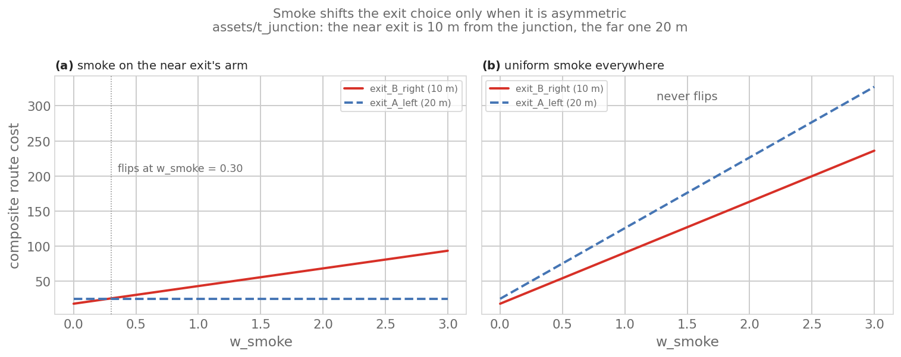

# T-junction test: smoke-blocked T-corridor

This scenario was built to exercise speed reduction, FED incapacitation and
dynamic rerouting. In the run at `dc45a496` (probabilistic incapacitation, no
irritant slowdown) speed reduction and FED act. Rerouting acts at spawn: with
foresight, 13 of the 150 agents that enter choose Exit A before they move, and
no agent changes exit on the way. `config_full_no_foresight.json` is the same
deck without foresight; there agents do switch on the way. See the results
below and [#195](https://github.com/PedestrianDynamics/pyFDS-Evac/issues/195).

## Geometry

A T-shaped corridor where agents spawn in a dead-end branch and must
walk through the fire zone to reach either exit.

```
  Exit A ←─── 20 m ───┬─── 10 m ───→ Exit B
  (left)               │ fire          (right)
                       │ at junction
                  ┌────┴────┐
                  │  agents  │  6 m wide
                  │  spawn   │  10 m deep
                  └─────────┘
```

- Horizontal corridor: 30 m x 3 m (y = 10 to 13)
- Vertical branch: 6 m x 10 m (x = 17 to 23, y = 0 to 10)
- Exit A at x = 0 (20 m from junction)
- Exit B at x = 30 (10 m from junction)
- `config.json`, `config_full.json` and `config_full_no_foresight.json` add
  200 agents in the branch over
  0–400 s (0.5 per second), so 150 have entered at the 300 s limit;
  `config_initial_pre*.json` place 100 agents there at t = 0

## Fire setup (t_junction.fds)

A 2 MW PVC-cable fire at the junction produces heavy soot and toxic
gases. The fire ramps up over 60 seconds.


| Property | Value |
|----------|-------|
| Fuel | PVC monomer C2H3Cl, explicit lumped reaction |
| Peak HRR | 2 MW (1000 kW/m^2 x 2 m^2) |
| Soot yield | 0.172 |
| CO yield | 0.063 |
| Heat of combustion | 10300 kJ/kg (Osburg et al. 2025, Table 2; #796) |
| HCl yield | 0.583 (all the chlorine) |
| HCN yield | none -- PVC carries no nitrogen |
| Ramp-up | 0 to 100% over 60 s |
| Ceiling height | 3 m |
| Grid | 0.25 m (120 x 52 x 12 cells) |

## FDS slice outputs

Horizontal slices at z = 2 m (head height):

| Slice quantity | Used by |
|----------------|---------|
| Extinction coefficient | Smoke-speed model |
| Carbon monoxide volume fraction | FED (CO narcosis) |
| Carbon dioxide volume fraction | FED (hyperventilation factor) |
| Oxygen volume fraction | FED (hypoxia) |
| Hydrogen cyanide volume fraction | FED (CN narcosis) |
| Hydrogen chloride volume fraction | FED (irritant) |
| Visibility | fds-viewer visualization only |

## What each feature does here

**Speed reduction.** Agents approaching the junction encounter
increasing extinction, reducing their walking speed via the
Frantzich-Nilsson correlation.

**FED incapacitation.** The 6 m branch narrows to a 3 m corridor,
creating a bottleneck at the junction. Agents queuing in heavy smoke
accumulate CO and HCl exposure. The high HCl yield from PVC drives the
irritant term, while CO and O2 depletion contribute to narcosis. Measured
over 150 agents at 2 MW: largest FED per agent median 0.14 and max 0.33,
largest FIC per agent median 13.65 (quartiles 8.57 and 29.51) against a
threshold of 1.0, one agent incapacitated by the probabilistic per-agent
thresholds, and 89 of 150 out within 300 s against 145 in clear air. With
`--enable-fic-speed` 25 of 150 get out and seven agents are incapacitated.

**Rerouting.** Exit B is initially closer (10 m vs 20 m), and in clear
air every agent takes it. In the fire, the agents spawned in the first
seconds choose Exit A at spawn: 13 of the 150 (the agents spawned every 2 s
from 0 to 22 s, and one at 40 s) end on Exit A, the other 137 on Exit B. The
choice follows the smoke the router foresees on B (the default `anticipate`
with unlimited `foresight_horizon_s`): B is refused or has the higher
travel-time risk τ, and the router ranks on τ first. That choice writes no
route-history row, and the run's route history holds only its header. Once
both routes are refused nobody switches: a rival replaces the
current exit only if its τ is more than 20 % lower
(`fallback_switch_margin` 0.2), and it is not.

The two journeys in `config_full.json` (`journey_0` to Exit A with weight 1,
`journey_0_1` to Exit B with weight 99) both start at the same spawn area and
both reach both exits. The spawn area is therefore not a preference area, so
the 1 : 99 weights allocate no one: they only set the exit an agent is
scripted to before the opening choice, which the ranking then overrides.

**Without foresight.** `config_full_no_foresight.json` is `config_full.json`
with `routing.anticipate` set to `false`: the router reads only the smoke
that is present. The same command gives 89 of 150 out, 22 agents ending on
Exit A and 128 on Exit B, and four route-history rows: two `smoke_reroute`
rows (agent 2 at 7 s and agent 3 at 9 s, Exit B to Exit A, when B is refused
and A is still feasible) and two `fallback` rows (agent 29 at 61 s and
agent 27 at 62 s, Exit A to Exit B, written when every route is refused).
Switches on the way happen when the router sees only the present smoke.

Measured at `dc45a496` with the command in step 2 below (`config_full.json`
and `config_full_no_foresight.json`, default seed) against the FDS output in
the project's data store (`t_junction/fire_2MW_PVC_796/`); the clear-air run
drops `--fds-dir` and the FDS history outputs, and the FIC run adds
`--enable-fic-speed`.

`config_initial_pre0.json`, `config_initial_pre30.json` and `config_initial_pre60.json` place 100 agents over the branch at t = 0 with a constant pre-movement of 0, 30 or 60 s and a 270 s limit; see [Evacuation with and without the fire](../../docs/howto-with-without-fire.md).

## Running

1. Run the FDS simulation:

```bash
fds assets/t_junction/t_junction.fds
```

2. Run the evacuation:

```bash
uv run python run.py \
  --scenario assets/t_junction/config_full.json \
  --fds-dir assets/t_junction \
  --incapacitation-mode probabilistic \
  --enable-rerouting \
  --reroute-interval 5 \
  --output-smoke-history smoke.csv \
  --output-fed-history fed.csv \
  --output-route-history routes.csv \
  --output-exit-history exits.csv \
  --output-sqlite t_junction.sqlite
```

`--fds-dir` is the folder that holds the FDS output of step 1.

Use `--scenario assets/t_junction/config_full_no_foresight.json` for the
variant without foresight.

## Smoke-weight sweep: when does smoke actually change the exit?

`tests/test_rerouting_smoke_sweep.py` drives this asset's geometry through the
composite cost (`cost_model: "additive"`) at a range of `w_smoke`, without
needing FDS output. `config_full.json` runs the default `gate` model, where its
`routing` keys `w_smoke` and `w_fed` have no effect.

The T puts exit B 10 m from the junction and exit A 20 m, so **distance alone
always prefers B**. With heavy extinction on B's arm:

| `w_smoke` | best exit | cost A | cost B |
|---|---|---|---|
| 0.0 | `exit_B_right` | 25.16 | 18.16 |
| 0.5 | `exit_A_left` | 25.16 | 30.73 |
| 1.0 | `exit_A_left` | 25.16 | 43.30 |
| 5.0 | `exit_A_left` | 25.16 | 143.87 |

The crossover is at **`w_smoke` ≈ 0.28**. Note that cost A never moves: smoke
charges only the route that passes through it.

### The control that matters

Under **uniform** smoke the choice never flips, at any weight. Uniform
extinction scales both routes by the same factor, so the shorter one stays
cheaper. Without this control, "smoke changed the exit" would be
indistinguishable from "a large cost term changed the exit" — the flip has to
require *asymmetric* smoke, and it does.

```bash
.venv/bin/python scripts/generate_smoke_weight_sweep.py
```



The tests deliberately pass no cognitive map, so the whole graph is visible and
knowledge cannot confound the cost question. Familiarity is exercised by
`familiarity_test_*` and by `assets/exit_visibility_alpha`.
