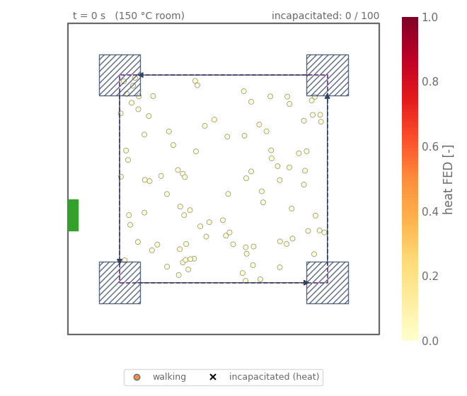
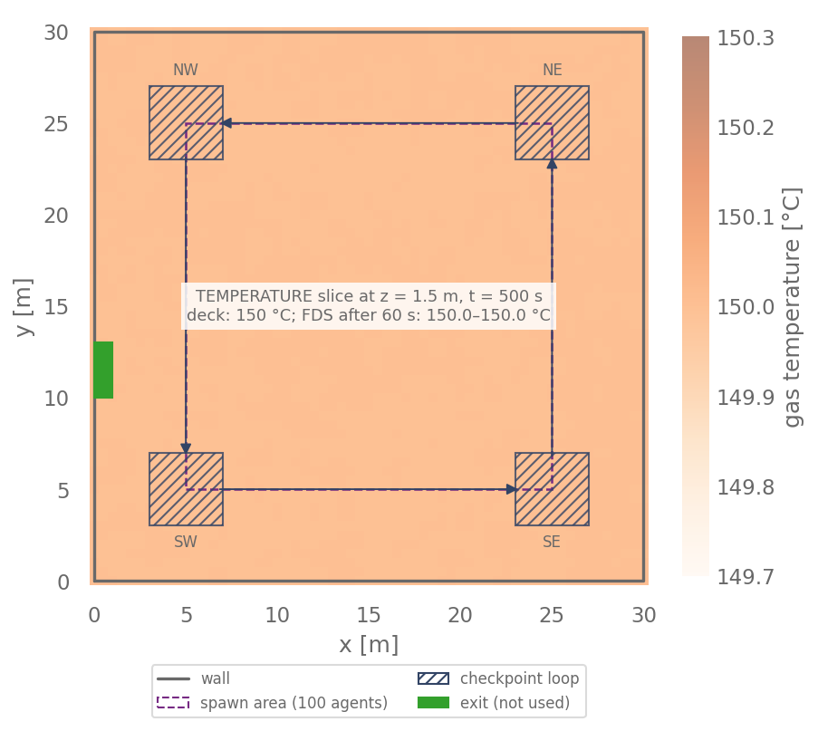
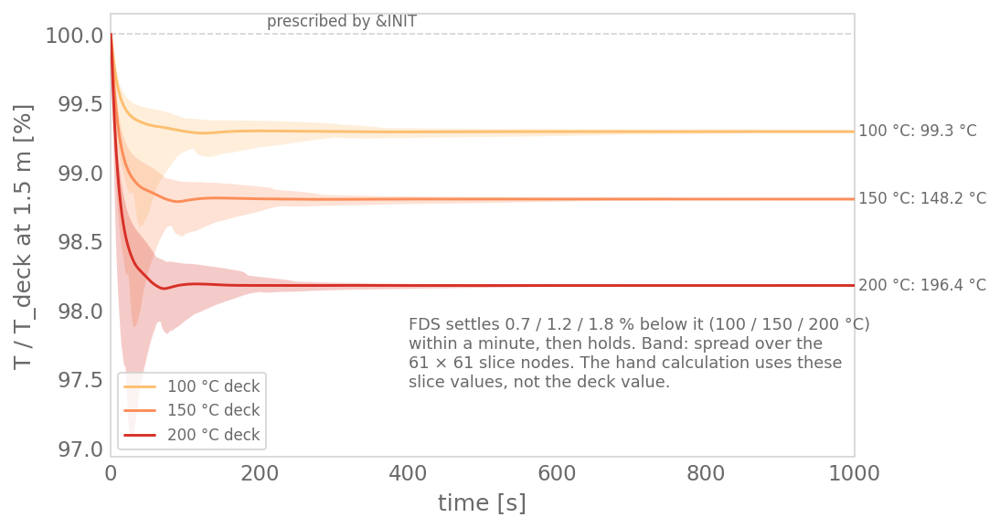
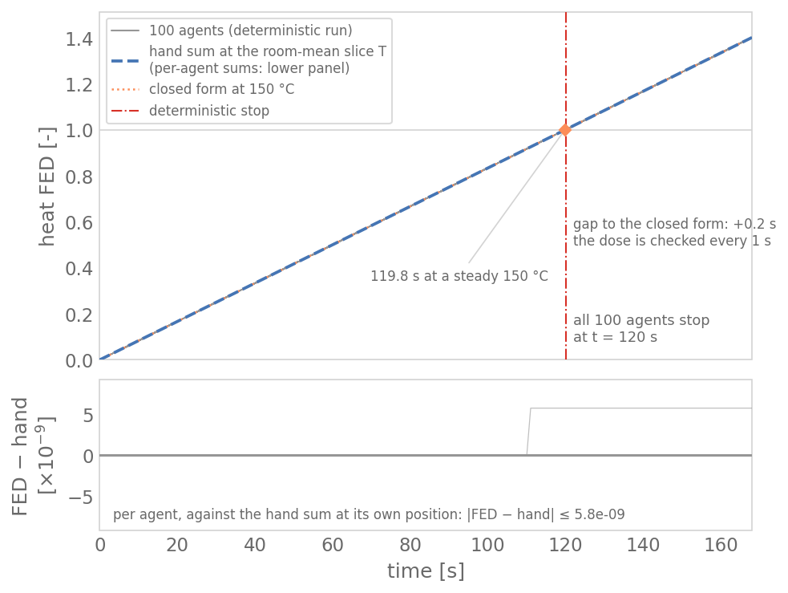
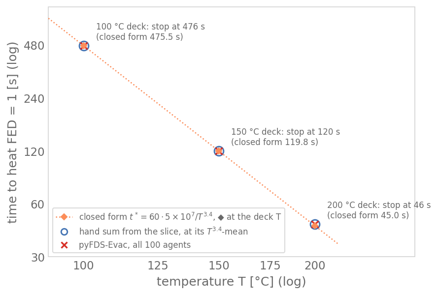
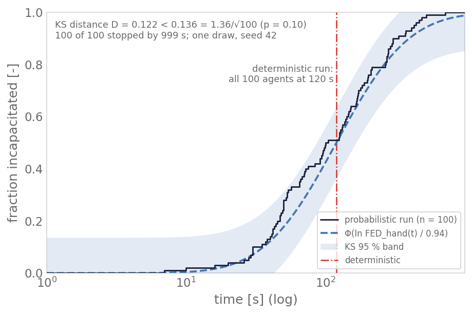

| | |
|---|---|
| **Component** | Heat FED and heat incapacitation ([Models › Heat](/models/heat.md)) |
| **Level** | FDS case: a full run on FDS output |
| **Asset** | `assets/fed_incap_heat_150c` (also `_100c` and `_200c`) |
| **Expected value from** | closed form of SFPE Eq. 63.44 (ISO 13571:2012 Eq. (10), `--heat-clothing unclothed`) and of ISO Eq. (9), the default, at the deck temperature; per agent, hand sum of Eq. 63.48 on FDS's own `TEMPERATURE` slice |
| **Status** | passes with `--heat-clothing unclothed` at 100, 150 and 200 °C, and with the default law, ISO Eq. (9), at 150 and 200 °C ([#307](https://github.com/PedestrianDynamics/pyFDS-Evac/issues/307)); checks the pipeline, not the law (the law against the Handbook's tables: `test_heat_fed_verif.py`, A3.8–A3.10, A3.12) |



## What is tested

Whether the heat dose an agent accumulates in pyFDS-Evac is the dose the
equation gives for the gas temperature FDS computed at that agent, and
whether the agent stops when the dose reaches its threshold. FDS holds the
room at the deck temperature everywhere, so every agent follows one curve,
the closed form. Any difference from the hand calculation comes from the code:
reading the slice, sampling it at the agent, summing the dose, or applying
the threshold. It checks that the code applies SFPE Eqs. 63.44 and 63.48
correctly, not that they predict human tolerance.

The runs use `--heat-clothing unclothed`. The default law is ISO 13571:2012
Eq. (9), for fully clothed subjects
([Models › Heat](/models/heat.md#clothing),
[#290](https://github.com/PedestrianDynamics/pyFDS-Evac/issues/290)). The
two laws share the pipeline this page checks and differ only in their
constants. The 150 and 200 °C decks are also run with the default law
([#307](https://github.com/PedestrianDynamics/pyFDS-Evac/issues/307)), deterministic only.
The 100 °C deck is too short for Eq. (9): it would reach FED = 1 at
1482 s, after the end of the 1000 s FDS record, so it is run with
Eq. (10) only. The default law is also checked on
synthetic fields by the S6 test
([`test_s6_heat_fed.py`](../tests/verification/test_s6_heat_fed.py)).

## Equation

SFPE Handbook 5th ed., Ch. 63 ([Models › Heat](/models/heat.md)); the
6th ed., Ch. 70, has the same equations as Eqs. 70.42 and 70.46. The time
to incapacitation by convected heat, with *T* the gas temperature in °C
(Eq. 63.44, p. 2382):

$$
t_{I,\mathrm{conv}} = 5\times10^{7}\,T^{-3.4}\ \text{min}.
$$

The Handbook states it for exposures of up to 2 h in air with less than
10 % water vapour by volume. ISO 13571:2012 gives the same expression as
its Eq. (10) (§8.3.2), for unclothed or lightly clothed subjects, cited to
Purser's chapter in the 4th edition of the Handbook, with an estimated
uncertainty of ±25 %
([Fundamentals › Heat](/fundamentals/heat.md#iso-135712012-clause-8)). The dose is summed over the exposure
(Eq. 63.48, p. 2383, without its radiant term), with Δ*t* in minutes:

```
FED_HEAT = sum_{t1}^{t2} [ T^3.4 / 5e7 ] * dt
```

Eq. 63.48 holds "providing that the temperature in the fire is stable or
increasing".

At a constant temperature the sum has a closed form, and FED = 1 is reached
at \(t^{*}\):

```
FED_HEAT(t) = (T^3.4 / 5e7) x t_min
```

$$
t^{*} = \frac{60 \times 5\times10^{7}}{T^{3.4}}\ \text{s}.
$$

A 1 % error in *T* (in °C) gives a 3.4 % error in the dose.

In the default `deterministic` mode every agent stops at FED = 1. In
`probabilistic` mode (opt-in) agent *i* stops at its own threshold
\(D_i = \exp(\sigma Z_i)\), \(Z_i \sim N(0,1)\), σ = 0.94, so the fraction
of agents stopped by time *t* is

$$
F(t) = \Phi\!\left(\frac{\ln \mathrm{FED}(t)}{\sigma}\right).
$$

## Setup



- **FDS:** a sealed 30 × 30 × 3 m room, no fire, no species, adiabatic on
  all six faces, four meshes. At *t* = 0 the whole room is set to 100, 150
  or 200 °C, and the ambient temperature `TMPA` is set to the same value, so
  the walls and the radiation field start at the gas temperature.
  `TEMPERATURE` slices at 1.5 m, the one nearest the 1.6 m sampling height
  on this 0.5 m grid.
- **Agents:** 100 agents walk a loop between four corner checkpoints and
  never leave. Each agent's temperature is sampled every second. Seed 42
  (the default `baseSeed`); the probabilistic run is repeated with seeds
  42 to 51.
- **Runs:** `--enable-heat-fed` (heat is off by default), deterministic (the
  default, given explicitly) at all three temperatures; probabilistic at
  150 °C, once per seed.
- **No soot:** the decks have no soot slice, so `run.py` warns that smoke
  speed reduction is off and that visibility falls back to clear air
  ([#248](https://github.com/PedestrianDynamics/pyFDS-Evac/issues/248)).
  Neither enters the heat-dose rate; clear-air visibility changes only where
  agents walk, and the expected dose is read at those positions.

## Expected

FDS holds the room at the deck value. Over the whole 1000 s, every node of
the 1.5 m slice stays within 0.65 mK of it, and every `TEMPERATURE` device
within 0.52 mK (`assets/fed_incap_heat_<T>c/fds/*_devc.csv`). A 1 mK error
moves the dose by at most 3.4 × 10⁻⁵, far below the margins in the Result
table. So the expected stop is the closed form at the deck temperature,
rounded up to the next 1 s dose update. Per agent, the expected dose is
also the sum of Eq. 63.48 over the temperature FDS wrote at the agent's
position, read from the slice with fdsreader, independent of pyFDS-Evac.



| Deck | \(t^{*}\) at the deck *T*, Eq. (10) | First update with FED ≥ 1 | \(t^{*}\) under ISO Eq. (9), the default | First update with FED ≥ 1 |
|---|---|---|---|---|
| 100 °C | 475.5 s | **476 s** | 1482.3 s | not run: after the 1000 s record |
| 150 °C | 119.8 s | **120 s** | 343.0 s | **343 s** |
| 200 °C | 45.0 s | **46 s** | 121.4 s | **122 s** |

The last column is \(60 \times 4.1\times10^{8}/T^{3.61}\) s.

The hand sum on the slice, taken at each agent's own position and update
times, first reaches 1 at the same update for all 100 agents. The gap to
the closed form (+0.5, +0.2 and +1.0 s) is the 1 s update interval: the
stop falls on the next update.

For the probabilistic run at 150 °C, *F*(999 s) = 98.8 % of agents are
expected to have stopped by the end.

## Result



At 150 °C every agent's dose equals its hand sum on the slice to
8.7 × 10⁻⁹. The difference comes from updates where an agent stands at a
node two meshes share; there the meshes differ by up to 9.2 × 10⁻⁵ K
([#239](https://github.com/PedestrianDynamics/pyFDS-Evac/issues/239)).
Summed from the temperature the agent recorded, the dose agrees to
2.2 × 10⁻¹³.



At all three temperatures the simulated stop (×) falls on the hand sum (○)
and on the closed form at the deck value (◆), up to the 1 s update.



| Check | Expected | Simulated |
|---|---|---|
| agent *T* against the slice, off shared nodes, 100 / 150 / 200 °C | ≤ 10⁻¹⁰ K | max 1.4 × 10⁻¹⁴ / 0 / 2.8 × 10⁻¹⁴ K |
| agent *T* against the slice, at shared nodes, 100 / 150 / 200 °C | ≤ 1.3 × 10⁻⁴ / 9.2 × 10⁻⁵ / 7.6 × 10⁻⁵ K | max 5.3 × 10⁻⁵ / 4.6 × 10⁻⁵ / 3.1 × 10⁻⁵ K |
| agent FED against the hand sum of its recorded *T*, 100 / 150 / 200 °C | ≤ 9.3 × 10⁻¹³ / 3.7 × 10⁻¹² / 9.9 × 10⁻¹² | max 4.4 × 10⁻¹⁴ / 2.2 × 10⁻¹³ / 5.9 × 10⁻¹³ |
| agent FED against the hand sum on the slice, 100 / 150 / 200 °C | ≤ seam bound, row by row | max 3.8 × 10⁻⁹ / 8.7 × 10⁻⁹ / 1.2 × 10⁻⁸, all within |
| margin of the hand FED from 1 at the updates around the stop, 100 / 150 / 200 °C | > seam bound up to the stop (≤ 1.8 / 1.0 / 0.86 × 10⁻⁷) | ≥ 9.8 × 10⁻⁴ / 1.8 × 10⁻³ / 9.4 × 10⁻⁴ |
| deterministic stop, 100 °C | 476 s | all 100 agents at 476 s |
| deterministic stop, 150 °C | 120 s | all 100 agents at 120 s |
| deterministic stop, 200 °C | 46 s | all 100 agents at 46 s |
| default law, Eq. (9): agent FED against the hand sum on the slice, 150 / 200 °C | ≤ seam bound, row by row | max 3.2 × 10⁻⁹ / 4.5 × 10⁻⁹, all within |
| default law, Eq. (9): deterministic stop, 150 °C | 343 s | all 100 agents at 343 s |
| default law, Eq. (9): deterministic stop, 200 °C | 122 s | all 100 agents at 122 s |
| cause of every stop | `heat` | `heat` |
| probabilistic, 150 °C, 10 seeds pooled: stopped by 999 s | 98.8 % | 985 of 1000 |
| probabilistic, 150 °C, 10 seeds pooled: largest gap between the curves | ≤ 0.043 | 0.034 (p = 0.21) |

## Pass criteria

1. **Slice to agent.** The temperature each agent recorded equals the slice
   value at its nearest node and nearest slice time, to float noise
   (10⁻¹⁰ K). The only larger difference allowed is at a node two meshes
   share, where the slice holds two values; there the tolerance is the
   largest such gap in the run (1.3 × 10⁻⁴, 9.2 × 10⁻⁵ and
   7.6 × 10⁻⁵ K).
2. **Dose.** Every agent's FED equals the hand sum of Eq. 63.48 over the
   temperatures it recorded to round-off. Both sums add *n* = 1000 positive
   terms, each rounding by at most *n* ε FED, so the tolerance is
   2 *n* ε FED_max with ε = 2.2 × 10⁻¹⁶ (9.3 × 10⁻¹³, 3.7 × 10⁻¹² and
   9.9 × 10⁻¹²). End to end, against the hand sum on the slice, each update
   at a shared node may add 3.4 · Δ*T*_seam / *T* · rate · Δ*t*, since a
   relative error in *T* grows 3.4 times in the rate. The seam bound is this
   term summed over the agent's updates at shared nodes.
3. **Deterministic stop.** Every agent stops at the first update where its
   hand sum reaches 1, with cause `heat`. Updates are 1 s apart
   (`--smoke-update-interval`). The stop is exact, not approximate, as long
   as the hand FED at the updates on either side of the stop is further from
   1 than the seam bound; otherwise the adjacent update would also pass. The
   tightest case is 200 °C: at least 9.4 × 10⁻⁴ from 1, against a seam
   bound of at most 8.6 × 10⁻⁸. The stop also equals the first update at
   or after the closed-form \(t^{*}\) at the deck temperature.
4. **Probabilistic stop.** The fraction of stopped agents, pooled over the
   probabilistic runs of seeds 42 to 51, stays within the 95 %
   Kolmogorov–Smirnov band of *F*(*t*), \(1.36/\sqrt{n} = 0.043\) for the
   pooled *n* = 1000 agents. Pooled, D = 0.034 (p = 0.21), so it passes.
   Each seed alone, against its own band of 0.136 for *n* = 100, gives
   D = 0.062 to 0.104 (median 0.075); none of the ten leaves its band.

## Run it yourself

The FDS slices are not in the repository (65 MB per deck); only FDS's
device output `*_devc.csv` is, under `assets/fed_incap_heat_<T>c/fds/`.
Either get the slices from the project's data folder
(`fds-evac-data/fed_incap_heat_<T>c/fds/`),
or rerun FDS outside the repository, about one minute per deck on four
cores:

```bash
mkdir -p <data>/fed_incap_heat_150c/fds && cd $_
cp <repo>/assets/fed_incap_heat_150c/fed_incap_heat_150c.fds .
mpiexec -n 4 fds fed_incap_heat_150c.fds
```

Then run pyFDS-Evac and draw the figures. The data folder must hold
`fed_incap_heat_<T>c/fds/` and `fed_incap_heat_<T>c/evac/deterministic/`,
and for 150 °C `evac/probabilistic_seeds/<seed>/`:

```bash
for T in 100 150 200; do
  uv run python run.py --scenario assets/fed_incap_heat_${T}c \
    --fds-dir <data>/fed_incap_heat_${T}c/fds \
    --enable-heat-fed --heat-clothing unclothed \
    --heat-incapacitation-mode deterministic \
    --output-sqlite <data>/fed_incap_heat_${T}c/evac/deterministic/run.sqlite \
    --output-fed-history <data>/fed_incap_heat_${T}c/evac/deterministic/fed_history.csv
done
for seed in $(seq 42 51); do
  uv run python run.py --scenario assets/fed_incap_heat_150c \
    --fds-dir <data>/fed_incap_heat_150c/fds \
    --enable-heat-fed --heat-clothing unclothed \
    --heat-incapacitation-mode probabilistic --seed $seed \
    --output-sqlite <data>/fed_incap_heat_150c/evac/probabilistic_seeds/$seed/run.sqlite \
    --output-fed-history <data>/fed_incap_heat_150c/evac/probabilistic_seeds/$seed/fed_history.csv
done
uv run python scripts/verification/heat_room_figures.py --data <data>
```

The default-law rows come from the same command without
`--heat-clothing`, at 150 and 200 °C, writing to
`<data>/fed_incap_heat_<T>c/evac/deterministic_clothed/`. With
`--law clothed` the figure script runs the same checks under Eq. (9) and
prints them; it draws no figures:

```bash
for T in 150 200; do
  uv run python run.py --scenario assets/fed_incap_heat_${T}c \
    --fds-dir <data>/fed_incap_heat_${T}c/fds \
    --enable-heat-fed --heat-incapacitation-mode deterministic \
    --output-sqlite <data>/fed_incap_heat_${T}c/evac/deterministic_clothed/run.sqlite \
    --output-fed-history <data>/fed_incap_heat_${T}c/evac/deterministic_clothed/fed_history.csv
done
uv run python scripts/verification/heat_room_figures.py --data <data> --law clothed
```

These runs were made at `2b52097c`.

Each run takes about three minutes; the deterministic runs use the default
seed 42. A temperature without output is skipped. The published runs were made when
Eq. 63.44 was the default law, before `--heat-clothing` existed;
`--heat-clothing unclothed` selects the same law, and
`tests/verification/test_heat_endpoint_coupled.py` checks, in a synthetic
corridor, that it reproduces the FED history of that code.

The figures and numbers on this page come from the commands above at
`92b8c5c`, stored in `<data>/fed_incap_heat_<T>c/evac_353/`; the ten
probabilistic runs at `8ef8dc7`, in
`<data>/fed_incap_heat_150c/evac_353/probabilistic_seeds/`.
Rerun on main at `dce7eae7`, after the per-distribution seeds (#360,
[#384](https://github.com/PedestrianDynamics/pyFDS-Evac/issues/384)),
in `<data>/fed_incap_heat_150c/evac_384/probabilistic_seeds/`, the pooled
check gave the same D = 0.034 (p = 0.21), but 982 of 1000 stopped by 999 s:
in seeds 43, 44 and 47 the last mobile agent was boxed in by incapacitated
ones, and the run ended as `deadlock` at 715, 772 and 900 s, before that
agent's threshold
([#988](https://github.com/PedestrianDynamics/pyFDS-Evac/issues/988)).
A deadlock no longer ends a run while a stuck agent's dose can still reach its threshold before the time limit.
Rerun with that rule on `632a97f4` plus the change, in
`<data>/fed_incap_heat_150c/evac_988/probabilistic_seeds/`, 985 of 1000
stop by 999 s again, and every agent stops at the same update as in
`evac_353` (max |Δt| = 0 s in all ten seeds). Seeds 43 and 47 end as
`all_mobile_left` at 786 s and 910 s. In seeds 44, 48 and 49 the agents
still inside cannot reach their thresholds by 1000 s, so the run ends as
`deadlock` (`ended_run` true). The pooled check is D = 0.034 (p = 0.21).
Earlier
figures came from runs that also passed
`--constant-extinction 0 --no-visibility`, which ran without a visibility
model. On the same FDS
output (the #253 rerun with `TMPA=150.`), a paired deterministic 150 °C
run with and without the two flags stops all 100 agents at 120 s in both,
and the maximum heat FED differs by less than 10⁻⁶ (relative). The agents
walk different paths (median 10 m apart when they stop); in the uniform
room the dose does not depend on position.
The paired outputs are in
`<data>/fed_incap_heat_150c/evac/no_soot_fallback_248/`.

## Checks against the Handbook

Beyond the FDS rooms above, the heat laws are checked at the equation level
and in coupled runs; [Models › Heat](/models/heat.md#verification)
summarises them.

The default, ISO Eq. (9), gives 1.8 to
3.0 times the convective times of Table 63.20 (p. 2383), and 10.7 min at
126 °C against the 7 min reported in Table 63.17 (p. 2375). Table 63.20
does not state clothing; Table 63.17's 205 °C row ("bare headed,
protected") gives 4 min, against 1.85 min from Eq. (9), and clothing is
not stated for its 126 °C row. These are recorded, not pass bands
(`test_heat_fed_verif.py`, A3.12).

Eq. 63.44 (`--heat-clothing unclothed`) is checked against the
convective rows of Table 63.20 (p. 2383) and the dry-air rows of
Table 63.17 (p. 2375). Against Table 63.20 it gives 0.61 to 1.07 times
the tabulated times, never longer than the table's whole-minute rounding
allows (read as ±0.5 min, an assumption); it never exceeds the times
reported as tolerated in Table 63.17's dry-air rows. The factor-2 band
the test allows is an assumption, not a sourced tolerance. The
`--heat-endpoint` laws are checked against Table 63.21 (`tolerance`) and
hand formulas
([#219](https://github.com/PedestrianDynamics/pyFDS-Evac/issues/219)).

The total-flux method is checked against hand formulas of Eqs. 63.49 and
63.43, the radiant rows of Table 63.20 and the convection table of [spec 016](https://github.com/PedestrianDynamics/pyFDS-Evac/blob/main/specs/016-heat-fed/SPEC.md),
in unit tests and coupled corridor runs. The radiant threshold is checked
in `tests/test_heat_radiant_threshold.py` for each radiant source (2.4
drops, 2.5 counts, a negative term counts as zero, convection unchanged,
`heat_flux_kw_m2` physical) and in the coupled cases of
`tests/verification/test_heat_total_flux_coupled.py`: dense smoke at
300 °C (tolerance, ε 0.9, *h* 8) crosses at 5.8 s, clear air at 100 °C
(tolerance, ε 0.05, *h* 8) at 190 s on convection alone, and smoke at
200 °C (fatal, ε 0.5, *h* 8) has a radiant term of 1.17 kW/m², below the
threshold.

The layer regime is checked
against hand formulas and the 200 °C / 2.5 kW/m² anchor (p. 2382), with
synthetic temperature fields, and on an FDS case
([#308](https://github.com/PedestrianDynamics/pyFDS-Evac/issues/308)), which
it misses in part: see [Layer regime against FDS gauges](#layer-regime-against-fds-gauges).

The `INTEGRATED INTENSITY` source is checked against hand formulas, a
committed FDS 6.10.1 case (`assets/heat_integrated_intensity`, slice *U*
and *T* against FDS's own devices), and the #224 radiometer data, where
*f* = 0.25 with convection matches the FDS skin gauge in an isotropic room
in all four orientations within 3 %. The 300 °C layer, soot fraction and
geometry of the committed case, and the gauge's h = 8 and \(T_s\) = 35 °C
in the #224 decks, are assumptions of those test decks, not sourced values.

## Layer regime against FDS gauges

`--heat-regime layer` (#308) on FDS 6.10.1 output of
`assets/heat_radiometer/heat_radiometer_layer_308.fds`: the #224 layer deck
(sealed adiabatic 4 × 4 × 3 m room, 300 °C sooty layer above 2.0 m, walls and
air below at 20 °C, 10 s) with a `TEMPERATURE` slice at 2.5 m and a device
`T_z25` added; every other namelist is unchanged, and the devices at 1.6 m
reproduce the #224 run exactly. The run is transient: the layer cools from
300 °C to about 260 °C and the head temperature at 1.6 m rises from 20 °C to
60 °C within 10 s, so the constant φ and ε_L meet a changing field.

The reference is the FDS `GAUGE HEAT FLUX GAS` device of the same position
and orientation (net flux of a skin-like gauge at 35 °C, *h* = 8), at 1.6 m
and *x* = 0.45–3.45 m on *y* = 2.05 m, facing up, +x (`px`) or −x (`mx`), at
*t* = 3, 6 and 9 s. The convective term is at most about 6 % of the flux (negative
at 3 s, while the air is below the gauge's 35 °C), so this case tests the
radiant layer term.

**View factor.** φ is not a free number here. It is the geometric view factor
from a differential element at the gauge, with the gauge's orientation, to
the base of the layer (the 4 × 4 m rectangle at z = 2.0 m, 0.4 m above the
gauge), the closed form for a differential element and a rectangle summed over
the four sub-rectangles around the foot point: Howell, *A Catalog of
Radiation Heat Transfer Configurations*, entries C-11 (parallel, `up`) and
C-14 (perpendicular, `px`, `mx`); also in Incropera, *Fundamentals of Heat
and Mass Transfer*. It is geometry, not a fit to FDS
(`scripts/verification/heat_layer_view_factor.py`; the test checks the closed
forms against numerical integration). φ values:

| *x* (m) | 0.45 | 0.95 | 1.45 | 1.95 | 2.45 | 2.95 | 3.45 |
|---|---|---|---|---|---|---|---|
| up | 0.861 | 0.946 | 0.964 | 0.968 | 0.966 | 0.951 | 0.891 |
| px | 0.419 | 0.413 | 0.405 | 0.391 | 0.366 | 0.317 | 0.204 |
| mx | 0.167 | 0.302 | 0.359 | 0.387 | 0.402 | 0.412 | 0.418 |

The layer regime takes one φ per run, so the CLI is run once per
(orientation, position) with that φ and one stationary agent read at the
device *x* (21 runs of the scenario in `assets/heat_radiometer_layer_308`,
seven agents with a pre-movement longer than the run).

**Predeclared, before the run.** Expected flux from φ, ε_L = 1, *T*<sub>L</sub> =
300 °C and the head temperature of the #224 run; band
|*q*<sub>model</sub> / *q*<sub>FDS</sub> − 1| ≤ 30 % (the radiant band
above) at every position and time, per orientation. A miss is a result: φ,
ε_L, the band and the times were not changed after the run.

**Result: a miss in every orientation.** The model flux against the FDS gauge,
7 positions per row (median flux in kW/m²; ratio *q*<sub>model</sub> /
*q*<sub>FDS</sub> over the positions):

| facing | *t* (s) | *q*<sub>FDS</sub> | *q*<sub>model</sub> | ratio min – max | inside ±30 % |
|---|---|---|---|---|---|
| up | 3 | 4.06 | 4.71 | 1.15 – 1.17 | 7 of 7 |
| up | 6 | 3.39 | 4.24 | 1.22 – 1.26 | 7 of 7 |
| up | 9 | 3.09 | 3.97 | 1.28 – 1.37 | 4 of 7 |
| px | 3 | 2.12 | 1.87 | 0.56 – 0.93 | 6 of 7 |
| px | 6 | 1.87 | 1.69 | 0.61 – 0.97 | 6 of 7 |
| px | 9 | 1.71 | 1.63 | 0.67 – 1.05 | 6 of 7 |
| mx | 3 | 2.02 | 1.86 | 0.46 – 0.94 | 6 of 7 |
| mx | 6 | 1.72 | 1.67 | 0.51 – 0.98 | 6 of 7 |
| mx | 9 | 1.71 | 1.61 | 0.55 – 1.06 | 6 of 7 |

54 of 63 (position, time) pairs are inside the band, 9 are outside: `up` at
*t* = 9 s for *x* = 1.45, 1.95 and 2.45 m (the model is 30–37 % above FDS);
`px` at *x* = 3.45 m and `mx` at *x* = 0.45 m at all three times, the
gauges that face the nearest wall at 0.55 m and 0.45 m, where φ is 0.20 and 0.17 and
the model is 33–54 % below FDS. The expected flux written down before the run
(layer at its initial 300 °C) lies inside the band for 34 of 63 pairs: it is
too high for `up` at 6 and 9 s (ratio 1.5–1.9) because the layer cools. The
implied φ<sub>eff</sub> = (*q*<sub>FDS</sub> − convective) /
(ε_L σ (*T*<sub>L</sub>⁴ − *T*<sub>s</sub>⁴)) is 0.67–0.84 for `up` against φ of
0.86–0.97, and 0.31–0.46 for the sides.

What the case does not show: why the model is high for `up`. The model
ignores the walls and the lower hemisphere: the layer base is the only
emitter in φ, while FDS's walls and floor start at 20 °C, absorb, and
re-emit (the #224 layer deck gives *q*/*U* of about 0.41 facing up, not
0.5). That reading is not tested here. Whether the ε_L = 1 assumption
(a black layer) contributes is not tested either.

Intermediate checks, all 63 pairs: the model flux equals the hand formula
from its own sampled temperatures to 2·10⁻¹⁰ kW/m² (tolerance 10⁻⁶); the
sampled layer temperature agrees with the `T_z25` device within 1.2 %
(tolerance 2 %); the sampled head temperature agrees with `T_z16` within
0.2 % at 3 s, 2.9 % at 6 s and 12 % at 9 s, when it rises by up to 20 K/s;
the 6 and 9 s deviations exceed the 2 % used for the slice–device check of
#221 and are recorded, not explained.

Reproduction: `python scripts/verification/heat_layer_308.py --fds-dir
fds-evac-data/heat_radiometer/layer_308 --out <dir>` (FDS 6.10.1-0-g12efa16,
4 ranks, 6 s wall time; output and the predeclared table in
`fds-evac-data/heat_radiometer/layer_308`). The test is
`external_data` and skips without that folder.

## Radiometer source against FDS gauges

`--heat-radiant-source radiometer` ([#276](https://github.com/PedestrianDynamics/pyFDS-Evac/issues/276))
reads the FDS `RADIOMETER GAS` devices of the #224 decks as the radiant term
and adds convection from the `TEMPERATURE` slice. Setting: seven device
positions on y = 2.05 m, z = 1.6 m, orientations up, +x, −x and down, h = 8
W/(m²·K), *T*<sub>s</sub> = 35 °C (the `&PROP` of the decks). The
radiometer and the FDS gauge hold the same radiation solution, so the
comparison checks the reader and the assembly of *q*, not the model, and
says nothing about whether a plate is a person.

**Gated** (`tests/verification/test_heat_radiometer_source_fds.py`; marked
`external_data`, skipped without the sciebo data):

- *Reading.* The radiometer term of the history row (the fields
  `heat_flux_row_fields` writes, sampled at the device positions through the
  model) equals an independent linear interpolation in time of `RAD_z16_<o>-k` at eight times between 1 and
  9.99 s, for the layer and uniform decks and all four orientations, to
  10⁻⁶ kW/m².
- *Identity.* *q* − `GAUGE_z16_<o>-k` = h (*T*<sub>slice</sub> −
  `T_z16-k`) / 1000 to 10⁻⁶ kW/m², the same cases, an identity of FDS
  Eq. 22.35 given the reading.
- *Threshold on the burner deck.* Where the net reading is 2.5 kW/m² or
  more the dose rate is *q*^1.33/16.7 per minute with the reading counted;
  below that it is the convective part alone, at every device position and
  every 0.5 s, facing +x and up.

**Reported, not gated.** |*q* / *q*<sub>gauge</sub> − 1| in percent
(min / median / max over the 7 positions), which equals h Δ*T* / *q* with
Δ*T* the slice against the device temperature:

| deck | facing | *t* = 3 s | *t* = 6 s | *t* = 9 s |
|---|---|---|---|---|
| layer | up | 0.00 / 0.01 / 0.01 | 0.02 / 0.06 / 0.19 | 0.47 / 1.22 / 1.92 |
| layer | +x | 0.01 / 0.01 / 0.02 | 0.04 / 0.12 / 0.34 | 0.88 / 2.06 / 3.48 |
| layer | −x | 0.01 / 0.01 / 0.02 | 0.05 / 0.12 / 0.42 | 0.80 / 2.36 / 3.39 |
| layer | down | 0.02 / 0.03 / 0.05 | 0.09 / 0.26 / 0.84 | 1.63 / 4.09 / 6.29 |
| uniform | all four | 0.00 / 0.00 / 0.00 | 0.00 / 0.00 / 0.00 | 0.00 / 0.00 / 0.00 |

The miss grows with time because the head air heats and the slice and the
device differ most then; it is largest facing down, where the gauge is
smallest (about 0.9 kW/m²) and the same h Δ*T* is a larger share.

**The 21 cases of #308 with the radiometer source** (`layer_308`, facing up,
+x and −x at the 7 positions, *t* = 3, 6, 9 s): all 63 (position, time)
pairs are inside ±30 %, against 54 of 63 for the layer term above. The
ratio *q*<sub>model</sub> / *q*<sub>FDS</sub> − 1 is −1.9 % at most facing up
(median −0.06 %), −3.5 % facing +x (median −0.12 %) and −3.4 % facing −x
(median −0.12 %); the identity above holds in each case. The wall-facing
gauges that the layer term missed by 33–54 % are within 3.5 %, as the
reading is FDS's own radiation solution at the point, walls included. The #308 agents spawn anywhere in 0.22 m boxes, off the one-row grid,
so the 21 cases are sampled at the device positions through the model, not
through coupled runs; the CLI stops with the coverage error for the
committed #308 scenario (also tested).

What this does not show: the radiometer source on a 2-D grid of FDS devices
(the #224 data hold one row; the 2-D interpolation is tested on synthetic
values only), and any difference between a plate and a body. A new FDS run
with a grid would show the first.

Reproduction: `HEAT_RADIOMETER_DATA=<data>/heat_radiometer uv run pytest
tests/verification/test_heat_radiometer_source_fds.py -s` prints the tables.
The data folders are read through a mirror and not changed.

## Test and reference-deck assumptions

Values of the test decks and test bands that no consulted source fixes. They
decide whether a test passes; they do not affect a run. The model's own
assumptions are on
[Models › Heat › Assumptions](/models/heat.md#assumptions-unsourced-values).

| Parameter | Value | CLI flag / config key | Where used | Why this value | What would source it |
|---|---|---|---|---|---|
| #224 decks: gas and soot | 300 °C, soot mass fraction 0.005; layer base 2.0 m | deck files `assets/heat_radiometer/*.fds` | FDS reference data; the `INTEGRATED INTENSITY` radiometer tests; the #308 case reads a copy of the layer deck | A sooty layer that radiates at head height | A measured compartment fire with radiometers |
| #224 decks: burner and grid | propane, soot yield 0.01, 0.6 × 0.6 m at 1100 kW/m²; 4 × 4 × 3 m room (6 × 4 × 4 m open for the burner), 0.1 m cells | deck files `assets/heat_radiometer/*.fds` | As above | A flame reaching head height on a grid that resolves 1.6 m | As above |
| #224 skin gauge | emissivity 1, h = 8 W/(m²·K), 35 °C | `&PROP` in the #224 decks and `assets/heat_integrated_intensity` | Gauge values the `INTEGRATED INTENSITY` tests compare against | Emissivity 1 is the FDS default, taken as the skin's; h = 8 is the top of the Handbook's 5–8 | Skin emissivity and h of a clothed person |
| #308 layer case | layer slice at 2.5 m, ε_L = 1, φ geometric per gauge (0.20–0.97), *h* = 8 W/(m²·K), *T*<sub>s</sub> = 35 °C, one agent per gauge position, 10 s | `--heat-regime layer --heat-layer-height 2.5 --heat-view-factor φ --heat-layer-emissivity 1 --heat-convective-coefficient 8 --heat-skin-temperature 35` | `tests/verification/test_heat_layer_fds_case.py` | 2.5 m is mid-layer of the 2.0–3.0 m layer; ε_L = 1 takes the 0.005 soot layer as black, not checked against FDS; φ is the view factor from the gauge to the layer base, not a fit | A measured layer emissivity and a view factor that includes the walls (#274, #275) |
| #221 CI deck | 300 °C sooty layer above 1.2 m, soot 0.005, 2 × 2 × 2.4 m, 0.2 m cells | `assets/heat_integrated_intensity/heat_integrated_intensity.fds` | `tests/verification/test_heat_integrated_intensity_coupled.py` | Two heights with different *U* in a small committed case | None needed: it checks the reader against FDS's own devices |
| Table reading | ±0.5 min | none (test) | Eq. 63.44 against Table 63.20 (`tests/verification/test_heat_fed_verif.py`, [#219](https://github.com/PedestrianDynamics/pyFDS-Evac/issues/219)) | Whole-minute entries read as rounded | The unrounded values behind Table 63.20 |
| Test band, convective | factor 2 | none (test) | Eq. 63.44 against Table 63.20 convective rows (#219) | Wide enough for the 0.61–1.07 spread found | None planned. ISO 13571:2012 states ±25 % for the identical Eq. (10) (§8.3.2); three rows (0.61–0.66) lie outside it. We read ±25 % as the uncertainty of Eq. (10) about its own data, not as agreement with Table 63.20, so the factor 2 stays; the data behind Eq. (10) (Purser 2008) were not consulted ([#289](https://github.com/PedestrianDynamics/pyFDS-Evac/issues/289)) |
| Test band, hot-layer anchor | ±10 % | none (test) | Black layer at 200 °C against "approximately 2.5 kW/m²" (p. 2382, #219) | "approximately" in the text | A precise flux for that anchor |
| Test band, radiant rows | ±30 % (±25 % in the #221 face-on check) | none (test) | Eq. 63.43 against Table 63.20 radiant rows (#219, #221); the same band for the #308 layer flux against the FDS gauges | Chosen in #219 | A stated uncertainty of Table 63.20 |
| Flame pass | black sphere, radius 0.1 m, 1000 °C; one pass FED < 0.02 | none (test) | `tests/verification/test_heat_flame_pass_reference.py` (#219) | A small flame; the pass stays far below the fatal dose | A measured flame and path |


## Limits

- **The law is not verified here.** The expected values use Eqs. 63.44 and
  63.48, the same formulas as the code. The law itself is compared with the
  Handbook's tables in `tests/verification/test_heat_fed_verif.py`
  ([#219](https://github.com/PedestrianDynamics/pyFDS-Evac/issues/219)):
  Eq. 63.44 gives 0.61 to 1.07 times the times of Table 63.20's convective
  rows (p. 2383), shorter at 100–140 °C (7.9 min against 12 min at 100 °C),
  as the Handbook says it is "somewhat overconservative at the
  low-temperature end" (p. 2382); and it never exceeds the dry-air
  tolerance times of Table 63.17 (p. 2375).
- **σ = 0.94 has no source for heat.** It is borrowed from the gas dose
  ([#225](https://github.com/PedestrianDynamics/pyFDS-Evac/issues/225)). The
  probabilistic runs check the code path, not the spread.
- **Convective heat only.** This room checks the convective laws; it does
  not run `--heat-fed-method total-flux`. That method is checked against
  hand formulas of Eqs. 63.49 and 63.43 on synthetic fields
  (`tests/test_heat_total_flux.py`,
  `tests/verification/test_heat_total_flux_coupled.py`). Its
  `--heat-regime layer` is checked the same way, against hand formulas and
  the 200 °C / 2.5 kW/m² anchor of p. 2382
  (`tests/test_heat_layer_flux.py`,
  `tests/verification/test_heat_layer_flux_coupled.py`) on synthetic fields,
  and on an FDS case with a geometric view factor
  (`tests/verification/test_heat_layer_fds_case.py`,
  [#308](https://github.com/PedestrianDynamics/pyFDS-Evac/issues/308)). The
  #224 radiometer decks are the reference data of the isotropic and burner
  checks ([Heat radiometer](testing-heat-radiometer.md)); the #308 case reads
  a copy of the layer deck.
  The `radiometer` source is checked in `tests/test_heat_radiometer_source.py`
  (hand formulas, coverage, horizon, `&PROP`, CLI rules) and, against the FDS
  data, in `tests/verification/test_heat_radiometer_source_fds.py`
  ([#276](https://github.com/PedestrianDynamics/pyFDS-Evac/issues/276)).
  The `INTEGRATED INTENSITY` source is checked in
  `tests/test_heat_integrated_intensity.py` and
  `tests/verification/test_heat_integrated_intensity_coupled.py`
  ([#221](https://github.com/PedestrianDynamics/pyFDS-Evac/issues/221)).
  The 2.5 kW/m² radiant threshold of total flux is checked in
  `tests/test_heat_radiant_threshold.py`. The layer anchor (2.33 kW/m² net
  for a black layer at 200 °C) is a check of the flux, not of the dose: it
  lies below that threshold and adds no radiant dose.
  Below the heat threshold (`--fed-threshold`, 1 by default) heat changes neither speed nor route
  ([#81](https://github.com/PedestrianDynamics/pyFDS-Evac/issues/81)).
- A near-uniform field cannot show whether the field is sampled at the
  agent's *current* position; that needs a gradient
  ([#24](https://github.com/PedestrianDynamics/pyFDS-Evac/issues/24)).
- The agent checks are not an automated test: they run from the figure
  script on the stored output. In CI,
  `tests/verification/test_heat_room_decks.py` checks the decks (adiabatic
  faces, `TMPA` equal to the `&INIT` temperature), that FDS's committed
  device output holds the deck value to 0.01 K, and the stop times in the
  table above. The equation-level tests
  (`tests/verification/test_s6_heat_fed.py`, `test_heat_fed_verif.py`) run
  on synthetic fields in CI. `test_heat_flame_pass_reference.py` and the
  radiant checks in `test_heat_fed_verif.py` (A3.11) call no pyFDS-Evac
  code: they are Handbook reference values kept apart from the total-flux
  method, which has its own tests (`tests/test_heat_total_flux.py`,
  [#223](https://github.com/PedestrianDynamics/pyFDS-Evac/issues/223)).
- The reference tests rest on choices that are not Handbook tolerances.
  Flame pass: the flame is a black-body sphere of radius 0.1 m, the skin
  faces it at 35 °C, there is no convective term, and one pass must stay
  below FED 0.02. Hot-layer anchor: a black-body layer with a full view,
  surface at 20 or 35 °C, within ±10 % of the Handbook's "approximately
  2.5 kW/m²". Table 63.20 radiant rows: within ±30 %, the band chosen in
  [#219](https://github.com/PedestrianDynamics/pyFDS-Evac/issues/219).
  D = 16.7 as printed on pp. 2382 and 2384 of Ch. 63.
