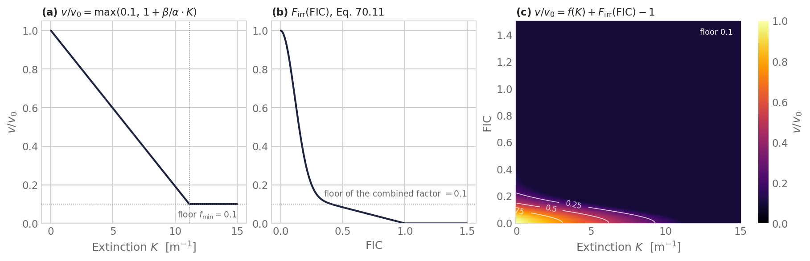
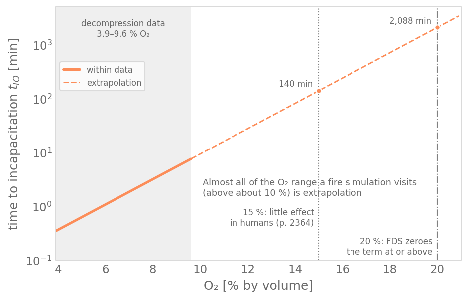

Based on: [Asphyxiant fractional effective dose](/fundamentals/asphyxiant-fed.md), [Irritant gases](/fundamentals/irritants.md), [Heat](/fundamentals/heat.md) and [Incapacitation thresholds](/fundamentals/incapacitation-thresholds.md).

Symbols follow the [notation table](/docs/concepts.md#notation). The model
codes the Purser sum in the form of the [FDS+Evac](https://github.com/firemodels/fds/tree/c9da70d7a/Source) guide (Korhonen 2021, §3.4),
which adds irritants into the dose; ISO 13571 keeps them in a separate
concentration endpoint. The published equations are on the Fundamentals pages
linked above.

Background: the [Concepts](/docs/concepts.md) page
and the talk [*A Modular Workflow for Visibility-Aware Evacuation Modelling*](https://pedestriandynamics.org/pyFDS-Evac/talks/visibility-seminar-2026/).

## Coded form

`FedComponents.total_rate_per_min` (`pyfds_evac/core/fed.py`) returns the
gas FED rate [1/min]

$$
\dot{\mathrm{FED}} = \bigl(\dot{\mathrm{FED}}_{\mathrm{CO}} + \dot{\mathrm{FED}}_{\mathrm{CN}} + \dot{\mathrm{FED}}_{\mathrm{NO_x}} + \dot{\mathrm{FLD}}_{\mathrm{irr}}\bigr) \times \mathrm{HV}_{\mathrm{CO_2}} + \dot{\mathrm{FED}}_{\mathrm{O_2}},
$$

and `DefaultFedModel` integrates it over time, with *t* in minutes. Each term
is one function in `fed.py`:

| Term | Function | Coded rate [1/min] | Input |
|------|----------|--------------------|-------|
| CO | `_co_fed_rate_per_minute` | \(2.764 \times 10^{-5}\, C_{\mathrm{CO}}^{1.036}\) | CO (ppm) |
| CN | `_cn_fed_rate_per_minute` | \(\max\bigl(0,\ \exp(C_{\mathrm{CN}}/43)/220 - 1/220\bigr)\), \(C_{\mathrm{CN}} = \max\bigl(0,\ C_{\mathrm{HCN}} - (C_{\mathrm{NO}} + C_{\mathrm{NO_2}})\bigr)\) | HCN, NO, NO2 (ppm) |
| NOₓ | `_nox_fed_rate_per_minute` | \((C_{\mathrm{NO}} + C_{\mathrm{NO_2}})/1500\) | NO, NO2 (ppm) |
| Irritants | `_irritant_fld_rate_per_minute` | \(\sum_i C_i / F_{\mathrm{FLD},i}\) | seven irritants (ppm) |
| HV_CO2 | `_hyperventilation_factor` | \(\exp(0.1903\, C_{\mathrm{CO_2}} + 2.0004)/7.1\) for \(C_{\mathrm{CO_2}} > 0\) (at least 1.041), and 1 without CO2, as in FDS; a run warns once if CO is sampled with zero CO2, which points to a deck with no ambient CO2 (a factor, not a rate) | CO2 (vol %) |
| O2 | `_o2_hypoxia_rate_per_minute` | \(1/\exp\bigl(8.13 - 0.54\,(20.9 - C_{\mathrm{O_2}})\bigr)\); 0 at or above `o2_threshold_percent`, 20.0 % by default | O2 (vol %) |

The lethal Ct doses \(F_{\mathrm{FLD},i}\) [ppm·min] are constants in
`_irritant_fld_rate_per_minute`, taken from Table 2 of the FDS+Evac guide:

| Species | HCl | HBr | HF | SO2 | NO2 | acrolein | formaldehyde |
|---------|------|------|------|------|------|----------|--------------|
| F_FLD | 114000 | 114000 | 87000 | 12000 | 1900 | 4500 | 22500 |

Gas species are read from FDS slice outputs via `fdsreader`. CO, CO2 and O2
are required. The optional species (HCN, NO, NO2, HCl, HBr, HF, SO2, acrolein,
formaldehyde), the guide's optional terms, are loaded when available; a
missing species reads 0 and contributes nothing. With only the three required
species the sum reduces to the FDS+Evac default,
\(\dot{\mathrm{FED}}_{\mathrm{CO}}\,\mathrm{HV}_{\mathrm{CO_2}} + \dot{\mathrm{FED}}_{\mathrm{O_2}}\).

## Convective heat

The heat dose is opt-in (`--enable-heat-fed`), as FDS+Evac has none, and is
a running total of its own, never added to the gas FED. By default it is
ISO 13571:2012 Eq. (9) for fully clothed subjects (`fed.py`,
`_heat_fed_rate_per_minute`),

$$
\dot{\mathrm{FED}}_{\mathrm{heat}} = T^{3.61} / (4.1 \times 10^{8}) \quad [1/\mathrm{min}],
$$

with *T* in °C. Everything else about it (the other laws, the total-flux
method, the threshold and its limits) is specified on
[Models › Heat](/models/heat.md).

## Tenability: irritant slowdown and incapacitation

`TenabilityConfig` (`fed.py`) adds two rules. The slowdown and the gas
stop need the gas FED model; the heat stop needs only the heat FED model
(`run_config.py`, `_build_tenability_config`).

- **Irritant slowdown, off by default.** FDS+Evac has no irritant slowdown, so
  `enable_fic_speed` defaults to false and `run.py` switches the rule on only
  with `--enable-fic-speed`. Before it became opt-in, it was on whenever a gas
  FED model was loaded. When on, `default_fic` sums \(C_i / F_{\mathrm{FIC},i}\) over the
  same seven irritants, not integrated over time. The constants in
  `_FIC_COEFFS_PPM` are the SFPE incapacitation column of Table 63.6, equal
  to FDS User's Guide Table 22.3 and FDS+Evac guide Table 2, so this FIC is
  neither the ISO 13571 FEC nor the escape-impairment FIC (see
  [Irritant gases](/fundamentals/irritants.md#which-endpoint-goes-in-the-denominator)).
  At each FED update the agent's irritant speed fraction is
  \(F_{\mathrm{irr}} = \bigl(e^{-(1000\,\mathrm{FIC}/160)^2} + 0.2 - 0.2\,\mathrm{FIC}\bigr)/1.2\)
  for 0 < FIC < 1 (Purser's Eq. 70.11; `fed.py`, `irritant_speed_fraction`),
  0 for FIC ≥ 1 and 1 for FIC = 0. It is added to the smoke loss as in
  Eq. 70.12, \(v/v_0 = f + F_{\mathrm{irr}} - 1\), with a floor of 0.1
  (`direct_steering_runtime.py`, `combined_speed_factor`,
  `set_agent_fic_factor`); a speed zone then multiplies the result. Each
  update in `run_scenario` (`scenario.py`) starts from the stored baseline
  speed, so the reduction does not compound, and FIC = 0 gives
  \(F_{\mathrm{irr}} = 1\), which leaves the smoke speed unchanged. FIC reduces speed but does not independently
  incapacitate agents; the combined environmental factor has a minimum of 0.1.
  How the rule compares with the published one is
  [below](#irritant-slowdown-against-the-published-rule).
- **Incapacitation.** Once the cumulative gas FED or heat FED reaches the
  agent's threshold for that dose, its desired speed is set to zero and it
  remains as a static obstacle. The speed is never restored (pre-movement,
  smoke, FIC, steering zones and checkpoints do not undo it), and the agent is
  not steered, rerouted or removed. Its exposure record ends with the collapse
  row. The run ends when only incapacitated agents remain
  ([Reading the results](/docs/outputs.md#reading-the-results)). In
  `probabilistic` mode each agent draws each threshold once, from a stream
  seeded by the run's seed and the agent's spawn order, as
  `_sample_threshold` does:
  \(D_i = \texttt{fed\_threshold} \cdot \exp(\sigma Z)\), \(Z \sim N(0, 1)\).
  In `deterministic` mode every agent uses the threshold itself. Both doses
  are deterministic by default: the gas dose as in FDS+Evac, and the heat
  dose since no population spread for heat is published. The heat dose uses
  the gas threshold `fed_threshold`, as ISO 13571:2012 asks for one
  threshold (§5.4); `heat_fed_threshold` overrides it, a departure from ISO
  ([Models › Heat](/models/heat.md#incapacitation)). An agent reaching its
  threshold in a run does not on its own show whether a design is
  acceptable; FED 1 describes the median occupant (see
  [Incapacitation thresholds](/fundamentals/incapacitation-thresholds.md)).

| Field | Default | CLI flag |
|---|---|---|
| `enable_fic_speed` | `False` | `--enable-fic-speed` |
| `fed_threshold` | `1.0` | `--fed-threshold` |
| `incapacitation_mode` | `"deterministic"` | `--incapacitation-mode` |
| `susceptibility_sigma` | `0.94` | `--susceptibility-sigma` |
| `heat_fed_threshold` | none, `fed_threshold` | `--heat-fed-threshold` |
| `heat_incapacitation_mode` | `"deterministic"` | `--heat-incapacitation-mode` |
| `heat_susceptibility_sigma` | `0.94` | `--heat-susceptibility-sigma` |
| `o2_threshold_percent` (`DefaultFedConfig`) | `20.0` | `--o2-threshold-percent` |

The gas and heat FED are updated every `DefaultFedConfig.update_interval_s`,
which `run.py` sets from `--smoke-update-interval`. `--disable-tenability`
turns off the slowdown and both stops; the doses are still computed. The FED
history CSV (`--output-fed-history`) carries the columns `fic`,
`fic_speed_factor` and `incapacitated`.

*(a) Frantzich–Nilsson factor f(K) [-] against K [1/m], floor 0.1.
(b) Irritant speed fraction F_irr(FIC) [-] against FIC [-], Purser's Eq. 70.11
(an estimated concept curve), 0 from FIC = 1; off by default. (c) The combined
factor [-] over K and FIC, f(K) + F_irr(FIC) − 1 with a floor of 0.1, with
contours at 0.25, 0.5 and 0.75. FED does not appear on these axes; it only sets
the speed to zero at the agent's threshold. Script:
`scripts/generate_tenability_curves.py`.*

## FDS input pitfalls

- **Conflicting `&INIT` records silently zero out prescribed gas
  concentrations.** FDS resets the *entire* domain's species composition on
  each `&INIT` record that has no `XB` bounding box, so a second `&INIT`
  (e.g. one that only sets soot) overwrites an earlier one (e.g. one that
  sets CO/CO2/O2), leaving those species at 0 with no warning. All species
  prescribed via `&INIT` in a test deck must go in a single record. This is
  an FDS input-authoring pitfall, not a pyFDS-Evac bug; its symptom is
  near-zero toxic gas readings.
- **Units.** FDS writes volume fractions; `FdsFedField.sample_inputs`
  (`fed.py`) multiplies CO, CO₂ and O₂ by 100 to get vol %, and the other
  gases by 10⁶ to get ppm.

## Verification

- [ISO 20414 Test 19](/verification/iso-test-19.md): passes for CO, CO₂ and
  O₂. The HCN, NOₓ and irritant terms are not verified end to end
  ([#257](https://github.com/PedestrianDynamics/pyFDS-Evac/issues/257)), and
  the coupled check compares against the code's own formula
  ([#249](https://github.com/PedestrianDynamics/pyFDS-Evac/issues/249)).
- [CO dose in a sealed room](/verification/testing-homogeneous.md): FDS cases
  at constant CO.
- FED and FIC in every zone
  ([`tests/verification/test_fed_fic_all_zones.py`](https://github.com/PedestrianDynamics/pyFDS-Evac/blob/main/tests/verification/test_fed_fic_all_zones.py)).
- Equation-level checks of every coded term
  ([`tests/test_fed.py`](https://github.com/PedestrianDynamics/pyFDS-Evac/blob/main/tests/test_fed.py)).

## What is not modelled

- Radiant heat from hot surfaces or a flame, except as the excess f·(U − 4σT_s⁴) from FDS
  `INTEGRATED INTENSITY` with `--heat-radiant-source integrated-intensity`
  and a user factor. Otherwise the heat dose is convective, or with
  `--heat-fed-method total-flux` adds the radiation of the gas at the head,
  or with `--heat-regime layer` that of a hot upper layer
  ([Heat](/models/heat.md)).
- Effects of heat on route choice or walking speed: the heat FED only
  incapacitates.
- FED activity level: the CO term is fixed at light work; rest and heavy
  work are not supported
  ([#135](https://github.com/PedestrianDynamics/pyFDS-Evac/issues/135)).
- Removing incapacitated agents: they stay where they collapsed until
  the run ends. The run ends when only incapacitated agents remain and no flow
  window is open (`end_reason` `all_mobile_left`), and `evacuation_time` is
  then the end of the loop, not an egress time; see
  [Limitations](/docs/limitations.md#evacuation-time-when-anyone-is-incapacitated).
- **Height-relative FED and smoke sampling**: extinction, temperature and
  each gas are sampled from the horizontal FDS slice closest to
  `--smoke-slice-height` (default 1.6 m, FDS+Evac `HUMAN_SMOKE_HEIGHT`). All agents share these slices regardless of
  their individual heights.  Pathfinder samples at 90 % of each occupant's height,
  which is more accurate for scenarios with mixed-height populations (children,
  wheelchair users).  A per-agent sampling height would require either multiple
  slice outputs at different elevations or 3-D slice data, and is a known
  approximation of the current model.

## Usage

See [docs/usage.md](/docs/usage.md) for the full catalogue of
`run.py` flags (scenario, FDS coupling, FED, rerouting, tenability)
and the post-processing scripts.

**Outside the FDS domain.** Where no gas slice covers the agent, the gases
read ambient air: CO 0 %, CO₂ 0 % (the atmospheric 0.04 % is not used),
O₂ 20.9 % and every optional species 0 ppm, so the FED rate is 0. This
matches FDS+Evac, and no warning is logged per sample. The FED history
marks such rows with `in_fds_domain = False`, and the run counts them at
the end. A point that some loaded gas slices cover and others do not stops
the run with a `ValueError` that names the point, the time and the missing
quantities ([#427](https://github.com/PedestrianDynamics/pyFDS-Evac/issues/427)).
With `--require-fds-coverage` any point outside stops the run. Details on
[FDS slice sampling](/docs/fds-sampling.md#outside-the-fds-slices).

## Deviations from the literature

The published forms are on [Asphyxiant FED](/fundamentals/asphyxiant-fed.md)
and [Irritant gases](/fundamentals/irritants.md). The gas sum has the Purser /
FDS+Evac guide structure (`fed.py`, `FedComponents.total_rate_per_min`), not the ISO 13571 one. Within it, the
code follows the guide, which cites the 3rd edition of the SFPE Handbook,
rather than the 5th edition, except that the HCN term is computed as FDS
computes it
([#149](https://github.com/PedestrianDynamics/pyFDS-Evac/issues/149)):

- **HCN.** The code computes the exponential term as FDS does,
  \(\exp(C_{\mathrm{CN}}/43)/220 - 1/220\) with
  \(C_{\mathrm{CN}} = C_{\mathrm{HCN}} - (C_{\mathrm{NO}} + C_{\mathrm{NO_2}})\)
  (`_cn_fed_rate_per_minute`), not the 5th-edition power law (Eq. 63.24;
  [#149](https://github.com/PedestrianDynamics/pyFDS-Evac/issues/149)). The
  FDS code that FDS+Evac runs subtracts NO + NO2, with the offset 0.00454545,
  about 1/220 (FDS 6.7.6 `func.f90`, function `FED`), and has done so since
  firemodels/fds 694e033 (2011); earlier versions had no HCN term. The
  FDS+Evac guide instead writes the offset as 0.0045 (Eq. 14) and
  \(C_{\mathrm{CN}} = C_{\mathrm{HCN}} - C_{\mathrm{NO_2}}\) (Eq. 15), which
  FDS and FDS+Evac never computed; pyFDS-Evac followed that text before
  ([#159](https://github.com/PedestrianDynamics/pyFDS-Evac/issues/159)). The
  FDS verification case `FED_FIC` separates the two forms and is reproduced in
  `tests/verification/test_fed_verif.py` (A2.8). The 5th edition also
  subtracts NO + NO2, because methaemoglobin formed by NO and NO2 binds
  cyanide (Ch. 63, p. 2370): with coefficient 1 in Eq. 63.26 (p. 2362) but
  0.67 in the note to the FED equation (p. 2372), so the chapter is
  inconsistent. No source we read supports NO2 alone, and the 3rd-edition
  wording the guide cites is not verified
  ([#152](https://github.com/PedestrianDynamics/pyFDS-Evac/issues/152)).
  Organic nitriles are ignored. Ch. 63 gives the critical range of its
  5th-edition time-to-incapacitation relationship as about 80 to 180 ppm,
  from primate and human data (p. 2361). That range is not documented for the
  exponential term; that the term is an extrapolation below 80 ppm is our
  inference ([#159](https://github.com/PedestrianDynamics/pyFDS-Evac/issues/159)).
- **NO₂ counted twice.** NO₂ enters both \(\dot{\mathrm{FED}}_{\mathrm{NO_x}}\)
  and \(\dot{\mathrm{FLD}}_{\mathrm{irr}}\), as in the FDS+Evac guide
  (Eqs. 16 and 17) and the `FED` function of FDS 6.7.6 `func.f90`. pyFDS-Evac
  keeps this form so that its gas FED matches FDS+Evac, and offers no option to
  drop either term. Whether Purser's scheme means NO₂ to appear in both terms
  of one incapacitation sum is not established
  ([#400](https://github.com/PedestrianDynamics/pyFDS-Evac/issues/400)). In a
  deck that writes NO₂, its share of the gas FED rate is therefore
  \(C_{\mathrm{NO_2}}(1/1500 + 1/1900)\,\mathrm{HV}_{\mathrm{CO_2}}\) per
  minute, 1.8 times the NOₓ term alone and 2.3 times the irritant term alone.
- **CO₂.** Eq. 63.34 (`fed.py`, `_hyperventilation_factor`), not its simplification Eq. 63.35 used in
  Eq. 63.38. The 70 L/min limit on \(V_E\times VCO_2\) is not applied, and
  the CO₂ asphyxiant endpoint \(F_{I_{CO_2}}\) is not computed.
- **CO.** Fixed at light work (`fed.py`, `_co_fed_rate_per_minute`), Eq. 63.18 at its default
  \(V_E\) and *D*.
- **O₂.** The rate is zero at or above `o2_threshold_percent`, 20.0 % O₂
  by default, the guard of FDS+Evac's code (the `FED` function of FDS 6.7.6
  `func.f90` adds the term only when X_O2 < 0.20); neither Purser nor the
  guide has it. It stops a tiny ambient rate from accumulating over long runs
  or outside the FDS domain. `--o2-threshold-percent 19.5` restores the
  previous default, the OSHA limit that Pathfinder uses. The O₂ rate is Handbook Eq. 63.50
  per minute, with no factor 60; see the warning below on the FDS+Evac
  guide's Eq. 18.

*Time to incapacitation by low oxygen, \(t_{IO}\) [min], Eq. 63.50: solid
over the decompression data (3.9–9.6 % O₂), dashed above. pyFDS-Evac
evaluates this law up to `o2_threshold_percent` (20 % by default, dash-dot
line, about 2090 min) and adds nothing at or above it; everything between
about 10 % and the gate is extrapolation. Dotted: 15 % O₂, down to which
there is little effect in humans (Purser & McAllister 2016, p. 2364). Figure
and sources: [Asphyxiant FED](/fundamentals/asphyxiant-fed.md). Script:
`scripts/figures/fundamentals_fed_o2.py`.*

> [!WARNING]
> **FDS+Evac guide, Eq. 18 (low O₂).** The guide (Korhonen 2021) divides the
> O₂ term by 60 while stating that *t* is in minutes. Taken literally, that
> gives an O₂ dose 60 times smaller than Purser's Eq. 63.50. The code
> FDS+Evac runs does not do this: FDS divides by 60 only because its time step
> is in seconds. pyFDS-Evac uses Eq. 63.50 per minute, as the code does. If
> you rebuild FDS+Evac's FED from the guide, leave the 60 out.
>
> Our reading is that the 60 survives from the 2009 guide, which gave the
> FED equations with *t* in seconds; the evidence is on
> [Asphyxiant FED](/fundamentals/asphyxiant-fed.md).

The heat laws and their deviations are on [Models › Heat](/models/heat.md).
The log-normal σ of both
thresholds (`fed.py`, `TenabilityConfig.susceptibility_sigma`, `TenabilityConfig.heat_susceptibility_sigma`) is, for the gas dose, a compromise between
two bin edges of NIST TN 1797, a report with no population data of its own:
it puts 10 % of agents below FED 0.3 and 88 % below 3, against the report's
11 % and 89 % (see [Incapacitation thresholds](/fundamentals/incapacitation-thresholds.md)
and [#148](https://github.com/PedestrianDynamics/pyFDS-Evac/issues/148)). σ
acts only in `probabilistic` mode: in the default `deterministic` mode every
agent uses `fed_threshold`, and σ has no effect. The heat dose is
deterministic by default; in `probabilistic` mode it reuses the same σ
without a data basis.

What σ means, as the share of agents whose threshold lies below FED 0.3, for
a log-normal with median `fed_threshold` = 1 and σ on the natural-log scale,
\(P = \Phi(\ln 0.3/\sigma)\) (our arithmetic):

| σ | Below FED 0.3 | Where the value comes from |
|---|---|---|
| 0.35 | 0.029 % | Ch. 70's HCN probit, 1 % at FICN 0.44 (p. 2302) |
| 0.52 | 1.0 % | Ch. 70's "approximately 1 %" below 0.3 (p. 2282) |
| 0.94 | 10.0 % | the default, the TN 1797 compromise |
| 1.00 | 11.4 % | ISO 13571:2012 A.5.2 |

The sources conflict. Ch. 70's 1 % (6th edition) and ISO's 11.4 % cannot
both hold for one log-normal with median 1, and the same Ch. 70 paragraph
puts 90 % below FED 1.3, which implies σ ≈ 0.2. The 5th edition gave
11.3 %. The 1 % is therefore one reading next to the others, not a
correction of the default.

### Irritant slowdown against the published rule

The irritant speed fraction \(F_{\mathrm{irr}}\), when enabled (`fed.py`,
`irritant_speed_fraction`), is Eq. 70.11 as published. Eq. 70.11 is an
estimated concept curve (Purser 2003, p. 94; SFPE Handbook 6th ed., Ch. 70,
p. 2289), not a law fitted to walking data. Its denominators are the SFPE
incapacitation column, the ones Eq. 70.11 takes (see
[Irritant gases](/fundamentals/irritants.md#irritants-and-walking-speed-fic)).

The combination is Eq. 70.12 as published: the irritant loss
\(1 - F_{\mathrm{irr}}\) is added to the smoke loss
(`direct_steering_runtime.py`, `combined_speed_factor`). Two departures from
the source, each one deliberate:

- **The floor at 0.1.** The sources do not clip the sum. The code floors the
  combined factor at 0.1, the floor FDS+Evac uses for its smoke law. The floor
  never raises a speed above the smoke-only speed.
- **\(F_{\mathrm{irr}} = 0\) above FIC = 1.** The formula would turn
  negative there.

FIC reduces speed but does not independently incapacitate agents; the combined
environmental factor has a minimum of 0.1. The sources predict incapacitation
at FIC = 1 (Purser 2003, p. 99; Ch. 70, p. 2289); in the code the agent walks
on at 0.1 of its free speed. Irritants count toward incapacitation only
through \(FLD_{irr}\) inside the gas FED
([#398](https://github.com/PedestrianDynamics/pyFDS-Evac/issues/398) for the
background).

The default smoke law (Frantzich–Nilsson) already contains mild irritancy, from
the acetic acid in its tunnel smoke, so adding the irritant loss still counts
some irritancy twice. The additive rule reduces the double counting; it does
not remove it
([#153](https://github.com/PedestrianDynamics/pyFDS-Evac/issues/153)).

*(a) Irritant speed fraction [-] against FIC [-]: Eq. 70.11 (solid over
0 ≤ FIC ≤ 1, dotted beyond, where the formula is negative) and the coded
\(F_{\mathrm{irr}}\) (dashed), which is 0 above FIC = 1. (b) Walking-speed
fraction [-] for smoke fractions \(F_s\) = 1, 0.75 and 0.5: the published
additive sum (solid, unclipped) against `combined_speed_factor` (dashed,
floored at 0.1), one colour per \(F_s\). Script:
`scripts/figures/models_fic_combination.py`.*
